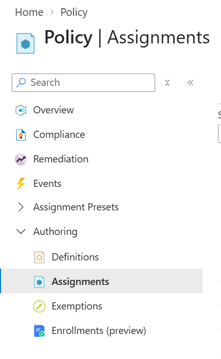

PAT Cloud Solutions · Einführung in Cloud Computing mit Microsoft Azure · Tag 2

# Auftrag 2.2: Dein Azure-Abonnement erkunden

Zeit: 30 Min. · Form: Einzelarbeit

## Ziel
- Du kannst dich im Azure-Portal anmelden und dein Abonnement (Subscription) finden. (K3)
- Du kannst nachschauen, wie viel Guthaben (Credit) du hast und welche Regionen du verwenden darfst. (K3)

## Voraussetzungen
- Dein Konto für Azure for Students (Anmeldedaten bereit)
- Input «Aufbau von Azure» gehört
- Theorie zum Nachlesen: [Kapitel 3 Aufbau von Azure](../../theorie/03-azure-aufbau.md)
- Lernjournal: Ordner `tag-2/2.2-abonnement-erkunden`

## Ausgangslage
Bevor die Velo Zürich AG etwas in Azure baut, will sie wissen: Was steht uns zur Verfügung? Wie viel Geld haben wir? Wo dürfen wir Ressourcen erstellen? Du schaust das in deinem eigenen Abonnement (Subscription) nach. Heute erstellst du in diesem Auftrag noch nichts.

> [!IMPORTANT]
> Auf Screenshots ist oben rechts deine E-Mail-Adresse zu sehen. Schneide sie weg, bevor du den Screenshot ins Lernjournal legst.

## Auftrag

### Schritt 1: Im Portal anmelden
Öffne [portal.azure.com](https://portal.azure.com) und melde dich mit deinem Konto für Azure for Students an.

**Kontrolle:** Du siehst die Startseite mit dem Titel «Azure-Dienste» und oben ein Suchfeld.

> [!TIP]
> Ist das Portal auf Englisch? Zahnrad oben rechts > **Language + region** > **Deutsch** > **Apply**.

### Schritt 2: Dein Abonnement finden
Das **Abonnement** (Subscription) ist dein «Vertrag» mit Azure. Darüber wird abgerechnet.

Tippe oben ins Suchfeld **Abonnements** (Subscriptions) und öffne den Dienst **Abonnements** (Subscriptions).

**Kontrolle:** In der Liste steht ein Abonnement (Subscription) mit dem Namen **Azure for Students** und dem Status **Aktiv**.

Notiere aus der Liste im Lernjournal:

| Was | Wert |
|-----|------|
| Name des Abonnements (Subscription) | |
| Status | |
| Meine Rolle (Role) | |

Die **Rolle** (Role) sagt, was du im Abonnement (Subscription) darfst. «Besitzer» (Owner) heisst: alles.

### Schritt 3: Wie viel Guthaben hast du?
Azure for Students gibt dir ein Startguthaben. Damit bezahlst du alles, was du im Kurs erstellst.

Tippe ins Suchfeld **Education** und öffne den Dienst **Education** (Azure Education Hub). Auf der Übersicht siehst du dein Guthaben (Credit). <!-- prüfen: Stand 28.10.2026 – Anzeige des Guthabens im Education Hub -->

**Kontrolle:** Du siehst einen Betrag (verbleibendes Guthaben) und ein Ablaufdatum. Notiere beides.

### Schritt 4: Welche Regionen darfst du verwenden?
Eine **Region** ist ein Gebiet mit Rechenzentren, z. B. Switzerland North (Zürich). Bei Azure for Students sind oft nur einige Regionen erlaubt. Das regelt eine **Richtlinie** (Policy): eine Regel, die Azure bei jeder neuen Ressource prüft.

1. Tippe ins Suchfeld **Richtlinie** (Policy) und öffne den Dienst **Richtlinie** (Policy).
2. Klicke links auf **Zuweisungen** (Assignments). Du findest sie unter **Authoring**. Ist der Eintrag zugeklappt, klicke zuerst auf den Pfeil davor.

   

3. Öffne die Zuweisung (Assignment) mit «allowed» oder «zulässig» und «regions» oder «Standorte» im Namen, z. B. «Allowed resource deployment regions». <!-- prüfen: Stand 28.10.2026 – Name der Zuweisung im Student-Abo -->
4. Klicke auf **Parameter anzeigen** (oder den Reiter **Parameter**).

**Kontrolle:** Du siehst eine Liste mit Regionen, z. B. `switzerlandnorth`, `westeurope`. Notiere alle.

> [!NOTE]
> Findest du keine solche Zuweisung (Assignment)? Dann ist in deinem Abonnement (Subscription) meist keine Region gesperrt. Zur Sicherheit testest du deine Kursregion in Schritt 4b.

### Schritt 4b: Kursregion testen (nur wenn du in Schritt 4 keine Zuweisung gefunden hast)
Du testest im Portal, ob Azure eine Region erlaubt. Dafür startest du das Erstellen eines **Speicherkontos** (Storage Account), also eines Speicherplatzes für Dateien in Azure. Du lernst es an Tag 3 genauer kennen. Heute brauchst du nur die Prüfung am Schluss. Du erstellst **nichts**, darum kostet der Test nichts.

1. Tippe ins Suchfeld **Speicherkonten** (Storage Accounts) und öffne den Dienst. Klicke auf **+ Erstellen**.
2. Fülle im Reiter **Grundeinstellungen** (Basics) aus:
   - Abonnement (Subscription): **Azure for Students**
   - Ressourcengruppe (Resource Group): **Neu erstellen** > `rg-test` > **OK**
   - Speicherkontoname: `sttest`, dazu deine Initialen und vier beliebige Ziffern, nur Kleinbuchstaben und Ziffern, z. B. `sttestam4821`
   - Region: **Switzerland North**
3. Klicke unten auf **Überprüfen + erstellen**. Klicke danach **nicht** auf **Erstellen**.

**Kontrolle:**
- Oben steht «Überprüfung erfolgreich» (Validation passed): Die Region ist erlaubt. Weiter mit Schritt 5.
- Es erscheint eine Fehlermeldung, dass die Region nicht erlaubt ist (oft mit «disallowed» im Text): Mach einen Screenshot der Meldung.
<!-- prüfen: Stand 08.11.2026 – mit einem Konto ohne Einschränkung getestet (Switzerland North und Brazil South erlaubt). Noch offen: Erscheint die Meldung bei einem eingeschränkten Konto schon bei «Überprüfen + erstellen»? Genauer Text? -->

4. Ist die Region nicht erlaubt: Klicke auf **Zurück** bis zum Reiter **Grundeinstellungen** (Basics), wähle die nächste Region und klicke wieder auf **Überprüfen + erstellen**. Teste in dieser Reihenfolge, bis eine Region erlaubt ist: **Germany West Central**, **France Central**, **West Europe**, **North Europe**.
5. Schliesse den Assistenten oben rechts mit **X**. Bestätige, dass du die Änderungen verwerfen willst.

Notiere im Lernjournal jede getestete Region mit dem Ergebnis «erlaubt» oder «nicht erlaubt».

**Kontrolle:** Unter **Speicherkonten** (Storage Accounts) und **Ressourcengruppen** (Resource Groups) ist nichts Neues entstanden.

### Schritt 5: Deine Kursregion festlegen
Ist `switzerlandnorth` in deiner Liste aus Schritt 4, oder war Switzerland North im Test in Schritt 4b erlaubt? Dann verwendest du im Kurs **Switzerland North**. Sonst nimmst du die erlaubte Region, die am nächsten bei der Schweiz liegt (z. B. `germanywestcentral` oder `francecentral`). Im Zweifel fragst du die Kursleitung.

**Kontrolle:** In deinem Lernjournal steht eine Zeile «Kursregion: …». Du brauchst sie ab Auftrag 2.3 immer wieder.

### Schritt 6: Was hast du bisher ausgegeben?
Die **Kostenanalyse** (Cost Analysis) zeigt, was deine Ressourcen gekostet haben.

Öffne wieder **Abonnements** (Subscriptions) > **Azure for Students**. Klicke links unter **Kostenverwaltung** (Cost Management) auf **Kostenanalyse** (Cost Analysis).

**Kontrolle:** Du siehst eine Grafik. Weil du noch nichts erstellt hast, sind die Kosten 0 oder fast 0. Notiere den Betrag und die Währung. <!-- prüfen: Stand 28.10.2026 – Kostenanalyse für Azure for Students verfügbar -->

### Schritt 7: Fragen
Kreuze im Lernjournal an.

| Aussage | richtig | falsch |
|---------|:---:|:---:|
| Ist mein Guthaben (Credit) aufgebraucht, werden meine Ressourcen gestoppt. | | |
| Eine Richtlinie (Policy) kann verhindern, dass ich eine Ressource in einer bestimmten Region erstelle. | | |
| Die Kostenanalyse (Cost Analysis) ist ein Beispiel für das Cloud-Merkmal «Messbarer Dienst». | | |
| Ressourcen, die ich nicht mehr brauche, kosten nichts, auch wenn ich sie nicht lösche. | | |

**Kontrolle:** Jede Zeile hat genau ein Kreuz.

## Erwartetes Ergebnis
Im Lernjournal:
- Tabelle aus Schritt 2, Guthaben (Credit) und Ablaufdatum aus Schritt 3
- Liste der erlaubten Regionen (Schritt 4) oder die getesteten Regionen mit Ergebnis (Schritt 4b)
- **deine Kursregion** (Schritt 5)
- Kosten bisher (Schritt 6) und Antworten aus Schritt 7
- ein Screenshot der Liste aus Schritt 4 oder der Meldung aus Schritt 4b (ohne E-Mail-Adresse)

## Wenn etwas nicht klappt

| Problem | Lösung |
|---------|--------|
| Kein Abonnement (Subscription) in der Liste | Oben rechts auf dein Konto klicken > **Verzeichnis wechseln** und das richtige Verzeichnis (Directory) wählen. Hilft das nicht: Kursleitung holen. |
| Status «Deaktiviert» | Guthaben (Credit) aufgebraucht oder abgelaufen. Kursleitung holen. |
| Schritt 4b: Fehler beim Speicherkontonamen («bereits vergeben» oder «ungültig») | Andere Ziffern wählen. Erlaubt sind nur Kleinbuchstaben und Ziffern, 3–24 Zeichen. |
| Schritt 4b: Aus Versehen auf **Erstellen** geklickt | Kein Problem: Ressourcengruppe (Resource Group) `rg-test` öffnen und **Ressourcengruppe löschen**. Kursleitung kurz informieren. |
| Kostenanalyse (Cost Analysis) zeigt eine Fehlermeldung oder bleibt leer | Kein Problem für heute. Notiere es und mach weiter. Die Daten erscheinen mit Verzögerung. |

## Quellen
- Microsoft Learn: [Beschreiben der Kernkomponenten der Azure-Architektur](https://learn.microsoft.com/de-de/training/modules/describe-core-architectural-components-of-azure/)
- Microsoft Learn: [Was ist Azure Policy?](https://learn.microsoft.com/de-de/azure/governance/policy/overview)
- Microsoft Learn: [Schnellstart: Kosten mit der Kostenanalyse untersuchen](https://learn.microsoft.com/de-de/azure/cost-management-billing/costs/quick-acm-cost-analysis)
- Microsoft Learn: [Azure Education Hub](https://learn.microsoft.com/de-de/azure/education-hub/about-education-hub)
