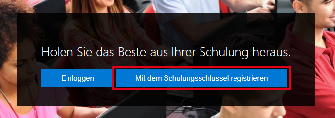
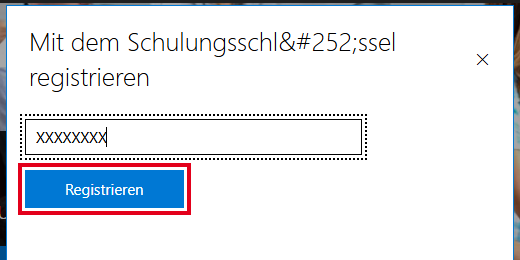
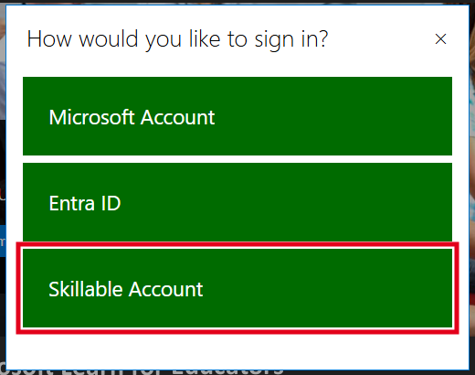

PAT Cloud Solutions · Einführung in Cloud Computing mit Microsoft Azure · Tag 2

# Auftrag 2.7 ⭐: Challenge Lab «Azure RBAC konfigurieren»

Zeit: ca. 45 Min. · Form: Partnerarbeit, freiwillig

## Ziel
- Du kannst einer Person eine Rolle für eine Ressourcengruppe (Resource Group) zuweisen. (K3)
- Du kannst erklären, was «wer – was – wo» bei der rollenbasierten Zugriffssteuerung (Role-Based Access Control) bedeutet. (K2)

## Voraussetzungen
- Aufträge 2.1 bis 2.5 erledigt
- Trainingsschlüssel der Kursleitung für die Klasse AZ-104 (steht im Kurskanal)
- Theorie zum Nachlesen: [Kapitel 3 Aufbau von Azure](../../theorie/03-azure-aufbau.md), Abschnitt «Ausblick: Identität und Zugriff»
- Lernjournal: Ordner `tag-2/2.7-challenge-lab-rbac`

## Ausgangslage
Bei der Velo Zürich AG soll ein neuer Lernender die Webshop-Ressourcen **ansehen**, aber nichts ändern oder löschen dürfen. Das regelt man in Azure mit **Rollen**. Eine Rolle wird einer Person für einen Bereich zugewiesen: *wer* (Person) – *was* (Rolle, z. B. Leser) – *wo* (Bereich, z. B. eine Ressourcengruppe).

In deinem Abonnement (Subscription) für Azure for Students darfst du keine Benutzer verwalten. Darum übst du in einem **Challenge Lab**: einer fertigen Übungsumgebung mit eigenem Testkonto und eigenem Azure-Zugang.

**Welches Konto?** Für die Labs brauchst du ein eigenes **Skillable-Konto**. Du erstellst es in Schritt 1 mit dem Trainingsschlüssel. Dein Konto für Azure for Students oder ein anderes Microsoft-Konto brauchst du dafür **nicht**. Im Lab arbeitest du mit einem Testkonto, das das Lab selbst mitbringt.

> [!IMPORTANT]
> Ein Lab lässt sich nur eine begrenzte Anzahl Male starten und läuft nach einer bestimmten Zeit ab. Starte es erst, wenn du mindestens 40 Minuten Zeit hast. <!-- prüfen: Stand 28.10.2026 – laut Skillable-FAQ für MSLE 10 Starts pro Modul, Speichern bis 7 Tage -->

## Auftrag

### Schritt 1: Mit dem Trainingsschlüssel registrieren (nur beim ersten Mal)
1. Öffne [msle.learnondemand.net](https://msle.learnondemand.net/).
2. Klicke auf **Mit dem Schulungsschlüssel registrieren**.

   

3. Gib im Fenster den **Trainingsschlüssel** der Kursleitung ein und klicke auf **Registrieren**.

   

4. Fülle das Formular aus: Vor- und Nachname, E-Mail-Adresse, Benutzername und Passwort. Nimm deine **Schul-E-Mail-Adresse**, keine private. Notiere dir Benutzername und Passwort. <!-- prüfen: Felder des Registrierungsformulars (nur mit gültigem Trainingsschlüssel sichtbar) -->
5. Akzeptiere die Lizenzbedingungen (End User License Agreement).

**Kontrolle:** Du siehst die Seite deiner Klasse **AZ-104** mit einer Liste von Labs.

> [!WARNING]
> Melde dich beim ersten Mal **nicht** über **Einloggen** an. Sonst ist dein Konto nicht mit der Klasse verbunden, und du siehst keine Labs.

<!-- Screenshot ergänzen, sobald eine Klasse aktiv ist: bilder/tag2-msle-klasse.png – Klassenseite AZ-104 mit Lab-Liste, ohne Namen -->

### Später wieder anmelden
Hast du dich schon registriert? Dann klicke auf **Einloggen** und wähle **Skillable Account**. Melde dich mit deinem Benutzernamen und Passwort aus Schritt 1 an. Die Klasse erreichst du auch direkt: [AZ-104 auf msle.learnondemand.net](https://msle.learnondemand.net/Class/777740).

### Schritt 2: Lab starten
Öffne in der Klasse **AZ-104** das Lab zur rollenbasierten Zugriffssteuerung (Role-Based Access Control), z. B. «Manage Subscriptions and RBAC». Klicke auf **Starten** (Launch). <!-- prüfen: genauer Lab-Name in der Klasse AZ-104 -->

<!-- Screenshot ergänzen: bilder/tag2-msle-lab.png – gestartetes Lab mit Umgebung links und Anleitung rechts -->

**Kontrolle:** Links öffnet sich die Lab-Umgebung, rechts die Anleitung. Die Anmeldedaten für das Testkonto stehen in der Anleitung.

### Schritt 3: Lab bearbeiten
Bearbeite die Aufgaben in der Anleitung. Teilt euch die Arbeit: Eine Person bedient, die andere liest vor und kontrolliert. Wechselt nach jeder Aufgabe.

**Kontrolle:** Am Ende zeigt das Lab, welche Aufgaben erfüllt sind.

### Schritt 4: Wer – was – wo
Fülle für eine Rollenzuweisung aus dem Lab die Tabelle aus:

| wer (Person oder Gruppe) | was (Rolle) | wo (Bereich) |
|--------------------------|-------------|--------------|
| | | |

Kreuze an: Der Lernende der Velo Zürich AG soll nur ansehen dürfen. Welche Rolle passt?

- [ ] Besitzer (Owner)
- [ ] Mitwirkender (Contributor)
- [ ] Leser (Reader)

## Erwartetes Ergebnis
Im Lernjournal:
- Screenshot der Lab-Auswertung (ohne persönliche Daten)
- Tabelle und Antwort aus Schritt 4

## Aufräumen
Nichts zu tun: Die Lab-Umgebung wird am Ende automatisch gelöscht. Beende das Lab mit **Fertig stellen** (oder **End**), wenn du fertig bist. <!-- prüfen: Bezeichnung der Schaltfläche und ob ein unterbrochenes Lab fortgesetzt werden kann -->

## Quellen
- Microsoft Learn: [Was ist die rollenbasierte Zugriffssteuerung in Azure (Azure RBAC)?](https://learn.microsoft.com/de-de/azure/role-based-access-control/overview)
- Microsoft Learn: [Integrierte Azure-Rollen](https://learn.microsoft.com/de-de/azure/role-based-access-control/built-in-roles)
- Skillable: [Microsoft Learn for Educators (MSLE) FAQ](https://www.skillable.com/courseware/moc/msle-faq/)
- Kurs: [Organisation, Abschnitt Challenge Labs](../../kurs/organisation.md#themen-mit-microsoft-entra-id-challenge-labs)
