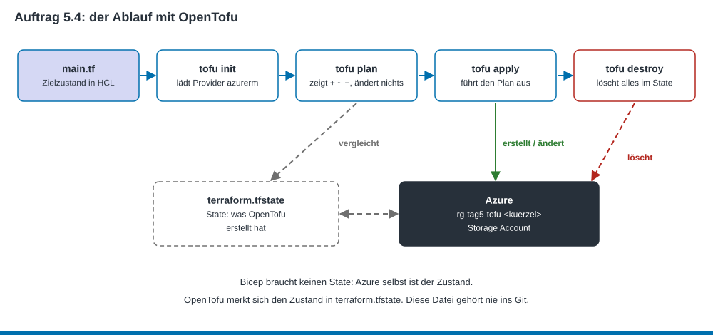

<sub>PAT Cloud Solutions · Einführung in Cloud Computing mit Microsoft Azure · Tag 5</sub>

# Auftrag 5.4 ⭐: Herausforderung – dieselbe Idee mit OpenTofu (Terraform)

Zeit: ca. 60 Min. · Form: Einzelarbeit, freiwillig

## Ziel
- Du kannst OpenTofu installieren und eine einfache Konfiguration für Azure schreiben. (K3)
- Du kannst die Befehle `init`, `plan`, `apply` und `destroy` anwenden und ihre Ausgabe lesen. (K3)
- Du kannst zwei Unterschiede zwischen OpenTofu und Bicep nennen. (K1)

## Voraussetzungen
- Aufträge 5.2 und 5.3 erledigt: Du kennst `what-if`, `create` und Idempotenz.
- Azure CLI, angemeldet mit `az login` (Auftrag 4.8)
- Lernjournal: Ordner `tag-5/5.4-opentofu`

> [!NOTE]
> OpenTofu und Terraform gehören nicht zum Kursinhalt. Dieser Auftrag ist ein Ausblick für alle, die mehr wollen. Er kostet fast nichts, du erstellst nur eine Ressourcengruppe (Resource Group) und ein Speicherkonto (Storage Account).

## Kurze Einführung: Terraform und OpenTofu
**Terraform** von der Firma HashiCorp ist das bekannteste Werkzeug für Infrastruktur als Code (Infrastructure as Code) über mehrere Clouds. 2023 hat HashiCorp die Lizenz geändert: Terraform ist seither nicht mehr Open Source. Daraufhin entstand **OpenTofu**, eine Abspaltung (Fork) von Terraform. OpenTofu gehört zur Linux Foundation, ist Open Source und kostenlos, auch für Firmen.

Für dich heisst das: OpenTofu funktioniert fast genau wie Terraform. Die Dateien und Provider sind dieselben, nur der Befehl heisst `tofu` statt `terraform`. Was du hier lernst, kannst du auch mit Terraform anwenden.

Wie Bicep ist OpenTofu **deklarativ**: Du beschreibst den Zielzustand, OpenTofu findet den Weg. Anders als Bicep funktioniert es nicht nur mit Azure, sondern auch mit AWS, Google Cloud und vielen weiteren Diensten. Für jede Plattform gibt es einen **Provider**, für Azure heisst er `azurerm`.

Die Dateien enden auf `.tf` und sind in **HCL** geschrieben (HashiCorp Configuration Language). OpenTofu merkt sich in einer **State-Datei** `terraform.tfstate`, was es erstellt hat. Der Name ist von Terraform übernommen.

| | Bicep | OpenTofu (Terraform) |
|---|-------|-----------|
| Hersteller | Microsoft | Linux Foundation (Terraform: HashiCorp) |
| Lizenz | Open Source | Open Source (Terraform: seit 2023 nicht mehr) |
| Plattformen | nur Azure | Azure, AWS, Google Cloud und viele mehr |
| Sprache, Dateien | Bicep, `.bicep` | HCL, `.tf` |
| Vorschau | `az deployment sub what-if` | `tofu plan` |
| Bereitstellen | `az deployment sub create` | `tofu apply` |
| Alles löschen | `az group delete` | `tofu destroy` |
| Wer kennt den Zustand? | Azure selbst | die State-Datei `terraform.tfstate` |

So läuft die Arbeit mit OpenTofu ab:



## Die wichtigsten Befehle

| Befehl | Was er macht | Bei Terraform |
|--------|--------------|---------------|
| `tofu init` | bereitet den Ordner vor und lädt den Provider herunter. Einmal pro Ordner. | `terraform init` |
| `tofu fmt` | rückt deine Dateien einheitlich ein | `terraform fmt` |
| `tofu validate` | prüft, ob die Dateien gültig sind | `terraform validate` |
| `tofu plan` | zeigt, was OpenTofu ändern würde: `+` erstellen, `~` ändern, `-` löschen. Ändert nichts. | `terraform plan` |
| `tofu apply` | zeigt den Plan, fragt nach und führt ihn aus | `terraform apply` |
| `tofu output` | zeigt die Ausgabewerte | `terraform output` |
| `tofu state list` | listet alles, was OpenTofu verwaltet | `terraform state list` |
| `tofu destroy` | löscht alles, was in der State-Datei steht | `terraform destroy` |

## Auftrag

### Schritt 1: OpenTofu installieren (PowerShell)
```powershell
winget install --exact --id OpenTofu.Tofu --accept-source-agreements --accept-package-agreements
```
Der Befehl installiert OpenTofu. Schliesse danach **alle** Terminals und öffne ein neues (**Terminal** > **New Terminal**).
```powershell
tofu -version
```

**Kontrolle:** Die Ausgabe beginnt mit `OpenTofu v1.`. <!-- prüfen: winget-Paket OpenTofu.Tofu auf den Kurs-Laptops -->

Für farbige Hervorhebung in Visual Studio Code: Öffne links **Erweiterungen** (Extensions) mit `Ctrl` + `Shift` + `X`, suche nach «OpenTofu» und installiere die Erweiterung des Herausgebers OpenTofu. <!-- prüfen: offizielle Erweiterung im Marketplace und ihr Herausgeber -->

### Schritt 2: Konfiguration schreiben
1. Lege im Ordner `azure-tag5` einen Ordner `5.4` an und darin die Datei `main.tf`:
    ```hcl
    terraform {
      required_providers {
        azurerm = {
          source  = "hashicorp/azurerm"
          version = "~> 4.0"
        }
      }
    }

    provider "azurerm" {
      features {}
      resource_provider_registrations = "none"
    }

    variable "kuerzel" {
      type = string
    }

    variable "region" {
      type    = string
      default = "switzerlandnorth"
    }

    resource "azurerm_resource_group" "rg" {
      name     = "rg-tag5-tofu-${var.kuerzel}"
      location = var.region
      tags = {
        kurs  = "azure-basics"
        tag   = "5"
        owner = var.kuerzel
      }
    }

    resource "azurerm_storage_account" "st" {
      name                     = "sttag5tofu${var.kuerzel}"
      resource_group_name      = azurerm_resource_group.rg.name
      location                 = azurerm_resource_group.rg.location
      account_tier             = "Standard"
      account_replication_type = "LRS"
    }

    output "blob_endpoint" {
      value = azurerm_storage_account.st.primary_blob_endpoint
    }
    ```
2. Ist deine Kursregion nicht `switzerlandnorth`, ändere den Standardwert bei `variable "region"`.
3. Wechsle im Terminal in den Ordner:
    ```powershell
    cd $HOME\azure-tag5\5.4
    ```

| Block | Bedeutung | In Bicep |
|-------|-----------|----------|
| `terraform { required_providers … }` | welcher Provider in welcher Version. Der Block heisst auch bei OpenTofu `terraform`. | – (Bicep kennt nur Azure) |
| `provider "azurerm"` | Einstellungen für Azure. `resource_provider_registrations = "none"` verhindert, dass OpenTofu im Abonnement (Subscription) Dienste anmelden will. | – |
| `variable "kuerzel"` | Eingabewert | `param kuerzel string` |
| `resource "azurerm_resource_group" "rg"` | Typ und Name in der Datei | `resource rg '…'` |
| `azurerm_resource_group.rg.name` | Verweis auf eine andere Ressource, legt die Reihenfolge fest | `rg.name` |
| `output` | Ausgabewert | `output` |

Wie deine `main.bicep` aus 5.2 erstellt OpenTofu auch die Ressourcengruppe (Resource Group) selbst. Ein `module` wie in Bicep braucht es dafür nicht: Jede Ressource bekommt ihre Ressourcengruppe (Resource Group) mit `resource_group_name`.

**Kontrolle:** Die Datei ist farbig hervorgehoben (Erweiterung aus Schritt 1).

### Schritt 3: OpenTofu mit deinem Abonnement verbinden (PowerShell)
OpenTofu verwendet deine Anmeldung aus `az login`. Es braucht zusätzlich die ID deines Abonnements (Subscription). Du gibst sie als Umgebungsvariable mit, damit sie nicht in der Datei steht:
```powershell
$env:ARM_SUBSCRIPTION_ID = (az account show --query id --output tsv)
echo $env:ARM_SUBSCRIPTION_ID
```
Die Variable gilt nur in diesem Terminal. Öffnest du ein neues, wiederholst du diesen Schritt.

**Kontrolle:** Die Ausgabe ist eine lange ID mit Bindestrichen, z. B. `1a2b3c4d-…`.

### Schritt 4: init
```powershell
tofu init
```

**Kontrolle:** Grün steht `OpenTofu has been successfully initialized!`. Im Explorer erscheinen der Ordner `.terraform` und die Datei `.terraform.lock.hcl`.

### Schritt 5: fmt und validate
```powershell
tofu fmt
tofu validate
```

**Kontrolle:** `validate` meldet `Success! The configuration is valid.`

### Schritt 6: plan
```powershell
tofu plan -var="kuerzel=<kuerzel>"
```
`-var` übergibt den Wert für `variable "kuerzel"`. Das entspricht `--parameters kuerzel=…` bei Bicep.

**Kontrolle:** Zwei Blöcke beginnen mit `+`. Eine Zeile lautet `Plan: 2 to add, 0 to change, 0 to destroy.` Den Hinweis zur Option `-out` darunter kannst du ignorieren.

### Schritt 7: apply
```powershell
tofu apply -var="kuerzel=<kuerzel>"
```
OpenTofu zeigt den Plan nochmals und fragt `Enter a value:`. Tippe `yes` und drücke `Enter`.

**Kontrolle:** `Apply complete! Resources: 2 added, 0 changed, 0 destroyed.` Darunter steht `blob_endpoint = "https://sttag5tofu<kuerzel>.blob.core.windows.net/"`.

### Schritt 8: Nachschauen
```powershell
tofu state list
tofu output
az group show --name rg-tag5-tofu-<kuerzel> --query tags
```

**Kontrolle:** `state list` zeigt `azurerm_resource_group.rg` und `azurerm_storage_account.st`. Die Tags sind dieselben wie in `main.tf`. Im Explorer liegt jetzt `terraform.tfstate`.

> [!WARNING]
> `terraform.tfstate` enthält alle Eigenschaften deiner Ressourcen, auch geheime wie die Zugriffsschlüssel (Access Keys) des Speicherkontos (Storage Account). Kopiere sie **nie** ins Lernjournal oder in ein Git-Repository.

### Schritt 9: Eine Änderung
Ergänze in `main.tf` bei der Ressourcengruppe (Resource Group) unter `tags` die Zeile:
```hcl
    umgebung = "test"
```
Speichere und schau dir den Plan an:
```powershell
tofu plan -var="kuerzel=<kuerzel>"
```

**Kontrolle:** Ein Block beginnt mit `~` (update in-place), darin `+ "umgebung" = "test"`. Eine Zeile lautet `Plan: 0 to add, 1 to change, 0 to destroy.`

Führe die Änderung mit `tofu apply -var="kuerzel=<kuerzel>"` aus und bestätige mit `yes`. Führe danach `tofu plan -var="kuerzel=<kuerzel>"` nochmals aus.

**Kontrolle:** Der zweite Plan meldet `No changes. Your infrastructure matches the configuration.` Wie bei Bicep: idempotent.

### Schritt 10: destroy
```powershell
tofu destroy -var="kuerzel=<kuerzel>"
```
Tippe `yes`.

**Kontrolle:** `Destroy complete! Resources: 2 destroyed.` und `az group list --output table` zeigt `rg-tag5-tofu-<kuerzel>` nicht mehr.

### Schritt 11: Fragen
Beantworte im Lernjournal.
1. Ordne zu: Welcher OpenTofu-Befehl entspricht welchem Bicep- bzw. CLI-Befehl?

    | OpenTofu | Bicep / Azure CLI |
    |-----------|-------------------|
    | `tofu plan` | |
    | `tofu apply` | |
    | `tofu destroy` | |

2. Kreuze an: Du löschst die Datei `terraform.tfstate` und führst `tofu plan` aus, obwohl die Ressourcen in Azure noch existieren. Was zeigt der Plan?
    - [ ] `No changes`, weil OpenTofu in Azure nachschaut.
    - [ ] `2 to add`, weil OpenTofu nicht mehr weiss, dass es die Ressourcen schon erstellt hat.
    - [ ] `2 to destroy`
3. Kreuze an: Die Velo Zürich AG nutzt Azure und zusätzlich AWS. Welches Werkzeug passt für beide?
    - [ ] Bicep, weil es von Microsoft ist
    - [ ] OpenTofu oder Terraform, weil sie mit Providern für viele Plattformen arbeiten
    - [ ] keines, man braucht für jede Cloud ein eigenes Werkzeug
4. Warum verwendest du im Kurs OpenTofu und nicht Terraform? Antworte in einem Satz.

## Erwartetes Ergebnis
Im Lernjournal:
- deine Datei `main.tf` (als Codeblock)
- die Ausgabe von `tofu plan` aus Schritt 9 (als Codeblock)
- Screenshot oder Codeblock von `Destroy complete!`
- Antworten aus Schritt 11
- **nicht**: `terraform.tfstate`, `.terraform` oder die ID deines Abonnements (Subscription ID)

## Wenn etwas nicht klappt

| Problem | Lösung |
|---------|--------|
| `tofu` wird nicht erkannt | Alle Terminals schliessen, neues öffnen. Hilft das nicht: Visual Studio Code neu starten. |
| `subscription ID could not be determined` | Schritt 3 im aktuellen Terminal wiederholen. |
| `could not acquire access token` oder `Please run 'az login'` | `az login`, dann Schritt 3 wiederholen. |
| `StorageAccountAlreadyTaken` | Name vergeben. In `main.tf` beim Speicherkonto (Storage Account) zwei Ziffern anhängen: `"sttag5tofu${var.kuerzel}07"`. |
| `RequestDisallowedByPolicy` | Region nicht erlaubt. Bei `variable "region"` deine Kursregion aus Auftrag 2.2 eintragen. |
| `Error acquiring the state lock` | Ein anderer OpenTofu-Befehl läuft noch oder wurde abgebrochen. Warten. Hilft das nicht, Kursleitung fragen. |
| `tofu destroy` vergessen, Ordner gelöscht | Ressourcengruppe (Resource Group) mit `az group delete --name rg-tag5-tofu-<kuerzel> --yes` löschen. |

## Aufräumen
Erledigt in Schritt 10. Prüfe zur Sicherheit:
```powershell
az group list --output table
```
Den Ordner `5.4` kannst du behalten. Willst du OpenTofu wieder entfernen: `winget uninstall --id OpenTofu.Tofu`.

## Quellen
- OpenTofu: [Installation unter Windows](https://opentofu.org/docs/intro/install/windows/)
- OpenTofu: [Befehle (CLI)](https://opentofu.org/docs/cli/commands/)
- OpenTofu: [Was ist OpenTofu?](https://opentofu.org/docs/intro/)
- OpenTofu Registry: [azurerm Provider](https://search.opentofu.org/provider/hashicorp/azurerm/latest)
- Microsoft Learn: [Terraform in Azure](https://learn.microsoft.com/de-de/azure/developer/terraform/overview) (gilt sinngemäss auch für OpenTofu)
