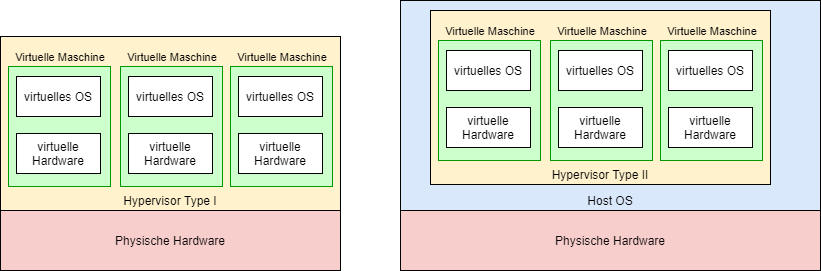
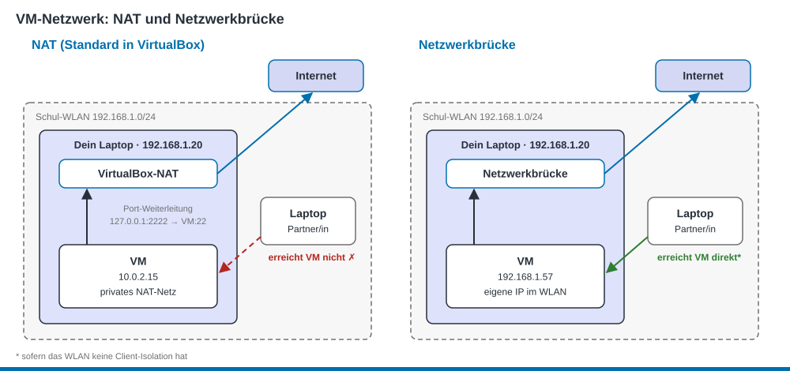
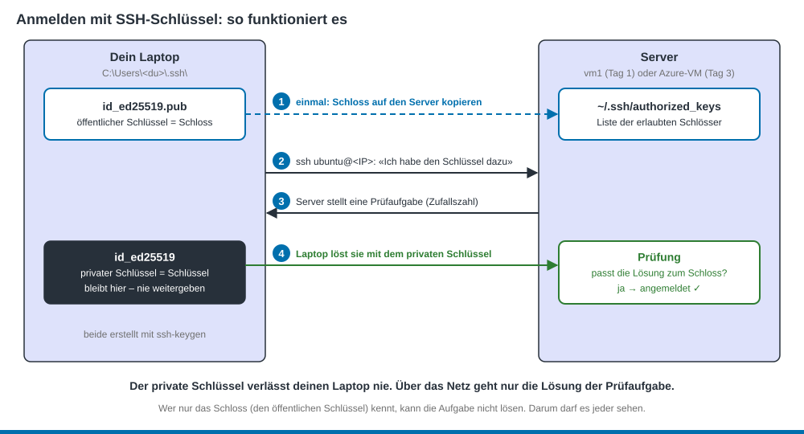
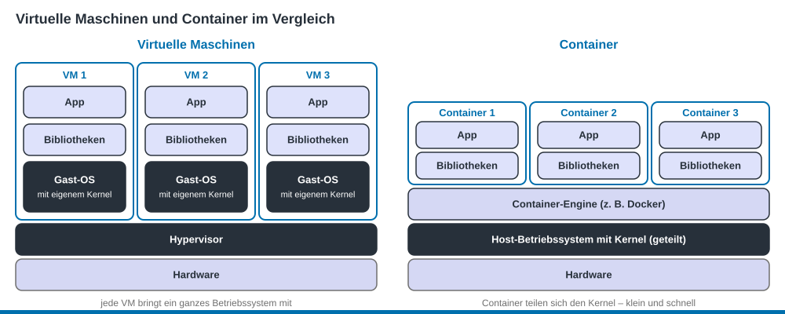

<sub>PAT Cloud Solutions · Einführung in Cloud Computing mit Microsoft Azure · Theorie</sub>

# 1 Virtualisierung

Stand: 26.10.2026 · gehört zu [Tag 1](../kurs/tag-1.md) · Lesezeit ca. 20 Min.

## Lernziele
- Du kannst erklären, was ein Hypervisor macht. (K2)
- Du kannst Hypervisoren dem Typ 1 oder Typ 2 zuordnen. (K2)
- Du kannst erklären, warum sich VMs die Hardware teilen können. (K2)
- Du kannst sagen, wozu Multipass und cloud-init dienen. (K1)
- Du kannst erklären, wie die Anmeldung mit einem SSH-Schlüsselpaar abläuft und welcher Schlüssel geheim bleibt. (K2)
- Du kannst den Unterschied zwischen VM und Container beschreiben. (K2)

## Was ist Virtualisierung?
Normalerweise läuft auf einem Computer **ein** Betriebssystem. Mit Virtualisierung laufen auf **einem** Computer **mehrere** Betriebssysteme gleichzeitig. Jedes davon läuft in einer **virtuellen Maschine (VM)**: einem Computer, der nur aus Software besteht.

Die Software, die das möglich macht, heisst **Hypervisor**. Sie teilt die echte Hardware (Prozessor, Arbeitsspeicher, Festplatte, Netzwerk) auf die VMs auf.

> **Alltagsvergleich:** Ein Mehrfamilienhaus. Das Gebäude ist die Hardware. Jede Wohnung ist eine VM mit eigener Tür und eigenen Möbeln. Die Hausverwaltung ist der Hypervisor: Sie teilt Wasser, Strom und Heizung zu.

**Wozu das Ganze?**
- Ein Server ohne Virtualisierung ist oft nur zu 10–20 % ausgelastet. Mit VMs wird er besser genutzt.
- Eine VM ist in Minuten erstellt und wieder gelöscht.
- Genau das macht Cloud Computing möglich: In Azure mietest du VMs, keine Computer.

## Typ 1 und Typ 2


<sub>Grafik: TBZ M346</sub>

| | Typ 1 | Typ 2 |
|---|---|---|
| Läuft … | direkt auf der Hardware | als Programm auf Windows, macOS oder Linux |
| Typischer Einsatz | Rechenzentren, Cloud | Laptop, Tests, Schulung |
| Beispiele | Microsoft Hyper-V, VMware ESXi, KVM | VirtualBox, VMware Workstation |

Schaltest du Hyper-V in Windows ein, startet der Hypervisor direkt auf der Hardware. Windows läuft danach selbst als besondere VM darauf. Darum ist Hyper-V Typ 1.

**Merke:** Auch **Azure** verwendet Hyper-V, in einer angepassten Version.

## Die Hardware teilen

Jede VM bekommt beim Erstellen einen Teil der Hardware:
- **vCPU** (virtueller Prozessor)
- **Arbeitsspeicher** (RAM)
- **Festplatte** (Disk)

Die VMs teilen sich die echten Prozessoren abwechselnd, in sehr kurzen Zeitabschnitten. Darum können alle VMs zusammen mehr vCPUs haben, als der Computer Prozessoren hat. Das heisst **Überbuchung** (Overcommitment). Solange nicht alle VMs gleichzeitig voll arbeiten, merkt man nichts. Arbeiten alle gleichzeitig, wird es langsam.

## Multipass: eine VM mit einem Befehl
Eine VM von Hand zu installieren dauert lange: Installationsdatei herunterladen, Installer durchklicken, Einstellungen wählen. **Multipass** von Canonical (der Firma hinter Ubuntu) erledigt das mit einem Befehl. Im Hintergrund verwendet es den Hypervisor deines Laptops (bei Windows Pro: Hyper-V).

| Befehl | Was er macht |
|--------|--------------|
| `multipass launch --name vm1` | VM «vm1» erstellen und starten |
| `multipass list` | alle VMs anzeigen |
| `multipass shell vm1` | Kommandozeile in der VM öffnen (`exit` zum Verlassen) |
| `multipass exec vm1 -- <befehl>` | einen Befehl in der VM ausführen |
| `multipass stop vm1` / `start vm1` | VM stoppen / starten |
| `multipass delete --purge vm1` | VM endgültig löschen |

## Automatisch einrichten mit cloud-init
Eine neue VM ist leer. Programme und Dateien musst du noch einrichten. **cloud-init** macht das automatisch: Du schreibst in eine Textdatei, was beim **ersten Start** passieren soll.

```yaml
#cloud-config
packages:
  - tree
write_files:
  - path: /opt/willkommen.txt
    content: |
      Diese Datei hat cloud-init erstellt.
```

| Block | Bedeutung |
|-------|-----------|
| `#cloud-config` | muss die erste Zeile sein |
| `packages` | Programme installieren |
| `write_files` | Dateien anlegen |
| `runcmd` | Befehle ausführen |

Mit Multipass: `multipass launch --name auto --cloud-init datei.yaml`. In Azure funktioniert es genau gleich – das machst du an Tag 5.

## Wie kommt die VM ins Netz?



- **NAT** (Standard): Die VM hat eine private Adresse in einem eigenen kleinen Netz. Sie kommt ins Internet, ist von aussen aber nicht erreichbar. Das ist sicher.
- **Netzwerkbrücke:** Die VM bekommt eine eigene Adresse im selben Netz wie dein Laptop. Andere Geräte erreichen sie direkt.

Multipass mit Hyper-V verwendet NAT. Dein Laptop erreicht die VM, andere Geräte nicht.

In Azure regelst du später mit einer **Netzwerksicherheitsgruppe (NSG)**, wer deine VM erreichen darf (Tag 4).

## Anmelden mit SSH-Schlüssel
Vor einem Server in der Cloud sitzt du nie. Du steuerst ihn über das Netz mit **SSH** (Secure Shell). SSH ist eine verschlüsselte Verbindung zur Kommandozeile des Servers.

**Warum kein Passwort?** Server im Internet werden ständig von Programmen angegriffen, die Passwörter durchprobieren. Ein Passwort kann man erraten, abschauen oder an mehreren Orten wiederverwenden. Darum meldest du dich mit einem **Schlüsselpaar** (Key Pair) an.

### Zwei Dateien, die zusammengehören
Der Befehl `ssh-keygen` erstellt zwei Dateien, die mathematisch zusammenpassen:

| Datei | Vergleich | Liegt wo? | Darf es jemand sehen? |
|-------|-----------|-----------|-----------------------|
| **öffentlicher Schlüssel** (Public Key) `id_ed25519.pub` | Schloss | auf jedem Server, an dem du dich anmelden willst, in `~/.ssh/authorized_keys` | ja, jeder |
| **privater Schlüssel** (Private Key) `id_ed25519` | Schlüssel | nur auf deinem Laptop in `~\.ssh\` | nein, niemand |

Das Schloss kannst du an beliebig viele Türen (Server) montieren. Öffnen kann sie nur, wer den passenden Schlüssel hat. Aus dem Schloss lässt sich der Schlüssel nicht nachbauen.

### So läuft die Anmeldung ab



1. **Einmal vorbereiten:** Du kopierst den öffentlichen Schlüssel auf den Server. Er steht dort in der Datei `authorized_keys`, der Liste der erlaubten Schlösser.
2. **Verbinden:** Du gibst `ssh ubuntu@<IP>` ein. Dein Laptop meldet: «Ich bin ubuntu und habe den Schlüssel zu diesem Schloss.»
3. **Prüfaufgabe:** Der Server findet das Schloss in `authorized_keys`. Er schickt eine Aufgabe mit einer Zufallszahl.
4. **Lösen:** Dein Laptop löst die Aufgabe mit dem privaten Schlüssel und schickt die Lösung zurück. Der Server prüft sie mit dem öffentlichen Schlüssel. Passt sie, bist du angemeldet – ohne Passwort.

Der private Schlüssel selbst geht nie über das Netz. Die Prüfaufgabe ist jedes Mal neu. Wer eine Lösung mitliest, kann sie beim nächsten Mal nicht mehr brauchen.

### Die Frage beim ersten Verbinden
Beim ersten Verbinden fragt SSH: `Are you sure you want to continue connecting (yes/no/[fingerprint])?`

Auch der Server hat ein eigenes Schlüsselpaar, den **Host-Schlüssel** (Host Key). SSH zeigt dir davon eine kurze Prüfsumme, den Fingerabdruck (Fingerprint). Mit `yes` merkt sich dein Laptop den Server in der Datei `known_hosts`. Meldet sich unter derselben IP später ein anderer Server, warnt SSH mit `REMOTE HOST IDENTIFICATION HAS CHANGED`. Im Kurs passiert das, wenn eine neue VM eine alte IP bekommt. Dann löschst du den alten Eintrag mit `ssh-keygen -R <IP>`.

> **Merke:** Den öffentlichen Schlüssel darfst du überall hinterlegen. Den privaten Schlüssel gibst du nie weiter: nicht per Chat, nicht per Mail, nicht in Git.

⭐ **Passphrase:** In Auftrag 1.6 drückst du bei der Frage nach einer Passphrase nur `Enter`. Eine Passphrase ist ein Passwort für den privaten Schlüssel. Wird der Schlüssel gestohlen, nützt er ohne Passphrase nichts. In der Praxis ist sie empfohlen.

## Container: die leichte Alternative



Ein **Container** ist ein verpacktes Programm. Er bringt kein eigenes Betriebssystem mit, sondern teilt sich den Kern (Kernel) mit anderen Containern. Darum ist er klein und startet in weniger als einer Sekunde. Das bekannteste Werkzeug dafür ist **Docker**.

| | VM | Container |
|---|---|---|
| Eigenes Betriebssystem | ja | nein |
| Startzeit | Sekunden bis Minuten | unter 1 Sekunde |
| Grösse | mehrere GB | wenige MB bis einige 100 MB |

## Vom Hypervisor zum Hyperscaler
Was passiert, wenn man tausende Server mit Hypervisoren zusammenschaltet und über das Internet steuert? Dann hat man eine Cloud. Mehr dazu in [Kapitel 2](02-cloud-grundlagen.md).

## Selbsttest

<details><summary>1. Was macht ein Hypervisor?</summary>

Er teilt die echte Hardware (CPU, RAM, Festplatte, Netzwerk) auf mehrere virtuelle Maschinen auf.
</details>

<details><summary>2. Typ 1 oder Typ 2: VirtualBox, Hyper-V?</summary>

VirtualBox ist Typ 2 (Programm auf Windows). Hyper-V ist Typ 1 (läuft direkt auf der Hardware).
</details>

<details><summary>3. Dein Laptop hat 8 Prozessoren. Drei VMs haben je 4 vCPUs. Geht das?</summary>

Ja. Die VMs teilen sich die echten Prozessoren abwechselnd (Überbuchung). Arbeiten alle gleichzeitig voll, wird es langsam.
</details>

<details><summary>4. Wann arbeitet cloud-init die Datei ab?</summary>

Nur beim ersten Start der VM.
</details>

<details><summary>5. Welche Datei kopierst du auf den Server: `id_ed25519` oder `id_ed25519.pub`?</summary>

`id_ed25519.pub`, den öffentlichen Schlüssel. Er kommt auf dem Server in `~/.ssh/authorized_keys`. `id_ed25519` ist der private Schlüssel und bleibt auf deinem Laptop.
</details>

<details><summary>6. Warum darf jeder deinen öffentlichen Schlüssel sehen?</summary>

Mit dem öffentlichen Schlüssel kann man nur prüfen, nicht anmelden. Die Prüfaufgabe lösen kann nur, wer den privaten Schlüssel hat.
</details>

<details><summary>7. Ein Kollege sagt: «Docker ist auch ein Hypervisor.» Stimmt das?</summary>

Nein. Docker startet Container. Container teilen sich den Kernel und haben kein eigenes Betriebssystem. Ein Hypervisor betreibt ganze VMs.
</details>

## Quellen
- TBZ M346: [Virtualisierung & Hypervisor](https://gitlab.com/ch-tbz-it/Stud/m346/m346/-/blob/main/Theorie/Virtualisierung.md), [Cloud-init](https://gitlab.com/ch-tbz-it/Stud/m346/m346/-/blob/main/Theorie/CloudInit.md), [Multipass](https://gitlab.com/ch-tbz-it/Stud/m346/m346/-/blob/main/Tools/Multipass.md) (übernommen und vereinfacht)
- TBZ M346: [SSH mit Public/Private Keys](https://gitlab.com/ch-tbz-it/Stud/m346/m346/-/blob/main/Theorie/SSH.md) (übernommen und vereinfacht)
- Microsoft Learn: [Schlüsselbasierte Authentifizierung in OpenSSH für Windows](https://learn.microsoft.com/de-de/windows-server/administration/openssh/openssh_keymanagement)
- TBZ M347: [Docker einfach erklärt](https://gitlab.com/ch-tbz-it/Stud/m347/-/blob/main/Container/docker/Readme.md)
- Microsoft: [Was ist Virtualisierung?](https://azure.microsoft.com/de-de/resources/cloud-computing-dictionary/what-is-virtualization)
- Microsoft Learn: [Hypervisor-Sicherheit in der Azure-Flotte](https://learn.microsoft.com/de-de/azure/security/fundamentals/hypervisor)
