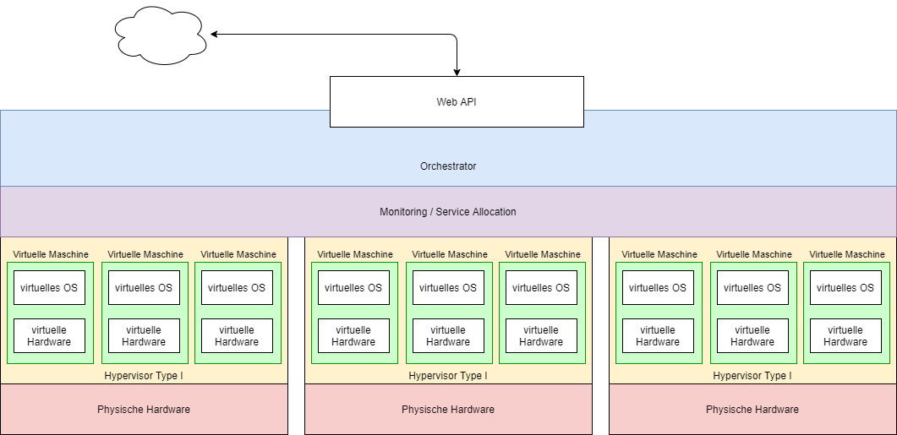
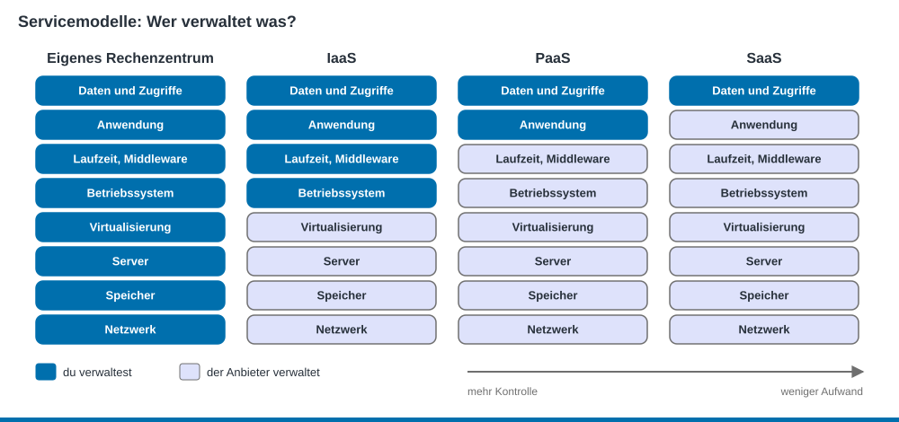
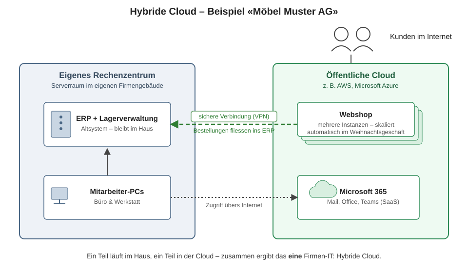

PAT Cloud Solutions · Einführung in Cloud Computing mit Microsoft Azure · Theorie

# 2 Cloud-Grundlagen

Stand: 19.10.2026 · gehört zu [Tag 2](../kurs/tag-2.md)

## Lernziele
- Du kannst erklären, was ein Hyperscaler ist und wie er mit Virtualisierung zusammenhängt. (K2)
- Du kannst die fünf Merkmale von Cloud Computing nennen. (K1)
- Du kannst IaaS, PaaS und SaaS unterscheiden und Beispiele zuordnen. (K2)
- Du kannst Public, Private und Hybrid Cloud unterscheiden. (K2)
- Du kannst erklären, wer in der Cloud für welche Sicherheit verantwortlich ist. (K2)

## Vom Hypervisor zum Hyperscaler
Ein **Hyperscaler** wie Microsoft Azure, AWS oder Google Cloud nimmt das Hypervisor-Prinzip und vervielfacht es: zehntausende Server, alle mit Typ-1-Hypervisoren. Ein **Orchestrator** verteilt die VMs auf die Server. Gesteuert wird alles über eine **Web-API**. Für dich sieht das aus wie ein fast unendlicher Pool an Ressourcen. Auf welchem Server deine VM landet, siehst du nicht.

Grafik: TBZ M346

## Die fünf Merkmale von Cloud Computing
Nach der Definition des NIST (US-Standardisierungsinstitut) ist etwas Cloud, wenn es diese fünf Merkmale hat:

| Merkmal | Bedeutung | Beispiel in Azure |
|---------|-----------|-------------------|
| Selbstbedienung auf Abruf | Du holst dir Ressourcen selbst, ohne jemanden anzurufen. | VM im Portal erstellen |
| Zugriff über das Netz | Alles ist über das Internet mit Standardwerkzeugen erreichbar. | Portal, CLI, API |
| Ressourcen-Pool | Viele Kunden teilen sich dieselbe Hardware, sauber getrennt. | Deine VM läuft neben VMs anderer Kunden. |
| Schnelle Elastizität | Ressourcen wachsen und schrumpfen nach Bedarf. | VM-Grösse ändern, mehr Instanzen |
| Messbarer Dienst | Du bezahlst, was du brauchst. | Kostenanalyse im Abonnement |

## Servicemodelle: Wer verwaltet was?
Bei den Servicemodellen geht es um eine Frage: **Wie viel Betriebsverantwortung gibst du an den Anbieter ab?** Je mehr du abgibst, desto weniger Kontrolle hast du, aber auch desto weniger Aufwand.

| Schicht | On Premises | IaaS | PaaS | SaaS |
|---|---|---|---|---|
| Daten und Zugriffe | du | du | du | du |
| Anwendung | du | du | du | Anbieter |
| Laufzeit, Middleware | du | du | Anbieter | Anbieter |
| Betriebssystem | du | du | Anbieter | Anbieter |
| Virtualisierung, Server, Netzwerk | du | Anbieter | Anbieter | Anbieter |

| Modell | Du lieferst … | Beispiele in Azure und Microsoft |
|--------|---------------|----------------------------------|
| **IaaS** – Infrastructure as a Service | Betriebssystem, Software, Konfiguration | Azure Virtual Machines, Virtual Network, Managed Disks |
| **PaaS** – Platform as a Service | nur deine Anwendung | Azure App Service, Azure SQL Database |
| **SaaS** – Software as a Service | nur deine Daten | Microsoft 365, Teams, Outlook |

Weitere Modelle: **FaaS** (Function as a Service, z. B. Azure Functions) führt nur einzelne Funktionen aus und kostet nur, wenn sie laufen. **CaaS** (Container as a Service) betreibt Container für dich.

> **Merkhilfe Pizza:**
> - **On Premises:** Du backst alles selbst, mit eigenem Ofen und eigener Küche.
> - **IaaS:** Du mietest eine Küche mit Ofen. Teig und Belag bringst du mit.
> - **PaaS:** Der Lieferdienst backt nach deinem Rezept.
> - **SaaS:** Du gehst ins Restaurant und isst, was auf der Karte steht.

**Im Kurs** arbeitest du vor allem mit **IaaS**: VMs, Netzwerke und Datenträger verwaltest du selbst.

## Bereitstellungsmodelle: Wo läuft die Cloud?

| Modell | Beschreibung | Typisch für |
|--------|--------------|-------------|
| **Public Cloud** | Infrastruktur eines öffentlichen Anbieters, geteilt mit anderen Kunden | die meisten Firmen, Start-ups |
| **Private Cloud** | Cloud-Infrastruktur exklusiv für eine Organisation | Banken, Behörden, besondere Vorschriften |
| **Hybrid Cloud** | Mischung: ein Teil im eigenen Rechenzentrum, ein Teil in der Public Cloud | heute der Normalfall |

Grafik: TBZ M346

Das typische Muster: **Neues und Wachsendes** geht in die Cloud, **Altes und schwer Migrierbares** bleibt vorerst im Haus.

## Geteilte Verantwortung (Shared Responsibility)
- **Microsoft** sorgt für die Sicherheit **der** Cloud: Rechenzentren, Hardware, Hypervisor, Trennung der Kunden.
- **Du** sorgst für die Sicherheit **in** der Cloud: Daten, Zugriffsrechte, offene Ports, Updates der VM.

Je weiter rechts das Servicemodell (IaaS → PaaS → SaaS), desto mehr übernimmt Microsoft. **Daten und Zugriffe bleiben immer deine Aufgabe.**

## Selbsttest

1. Ordne zu: Azure Virtual Machines, Microsoft Teams, Azure App Service.

IaaS, SaaS, PaaS.

2. Eine Firma will ihre eigene Web-App mit möglichst wenig Betriebsaufwand in die Cloud bringen. Welches Modell passt?

PaaS. Die App läuft auf einer verwalteten Plattform. Bei IaaS müsste sich die Firma um Betriebssystem und Updates kümmern. SaaS hiesse, die eigene App durch ein fertiges Produkt zu ersetzen.

3. Eine Treuhandfirma hat ihre Buchhaltung auf einem Server im Keller und nutzt Microsoft 365. Welches Bereitstellungsmodell ist das?

Hybrid Cloud.

4. Eine VM in Azure wird gehackt, weil der SSH-Port mit Passwort für alle offen war. Wer ist verantwortlich?

Der Kunde. Die Konfiguration der VM und der Netzwerkregeln ist «Sicherheit in der Cloud».

5. Welches Cloud-Merkmal nutzt du, wenn du in der Kostenanalyse siehst, was deine VM gestern gekostet hat?

Messbarer Dienst (Measured Service).

## Quellen
- TBZ M346: [Servicemodelle](https://gitlab.com/ch-tbz-it/Stud/m346/m346/-/blob/main/Theorie/Servicemodelle.md) (Texte), [Betriebsmodelle](https://gitlab.com/ch-tbz-it/Stud/m346/m346/-/blob/main/Theorie/Betriebsmodelle.md), [Virtualisierung](https://gitlab.com/ch-tbz-it/Stud/m346/m346/-/blob/main/Theorie/Virtualisierung.md) (Texte und Grafiken übernommen und angepasst)
- Microsoft Learn: [Beschreiben von Cloud Computing](https://learn.microsoft.com/de-de/training/modules/describe-cloud-compute/)
- Microsoft Learn: [Beschreiben von Clouddiensttypen](https://learn.microsoft.com/de-de/training/modules/describe-cloud-service-types/)
- Microsoft Learn: [Gemeinsame Verantwortung in der Cloud](https://learn.microsoft.com/de-de/azure/security/fundamentals/shared-responsibility)
- NIST: [SP 800-145 – The NIST Definition of Cloud Computing](https://csrc.nist.gov/pubs/sp/800/145/final)
