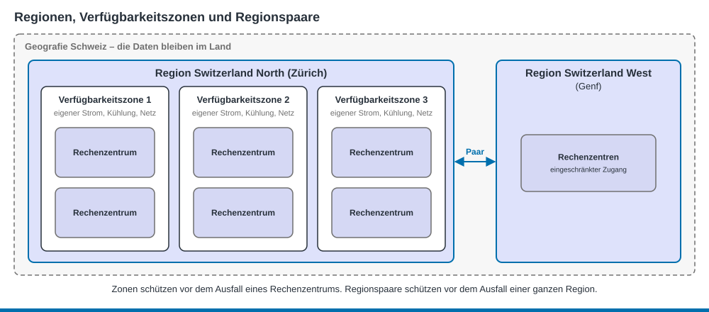
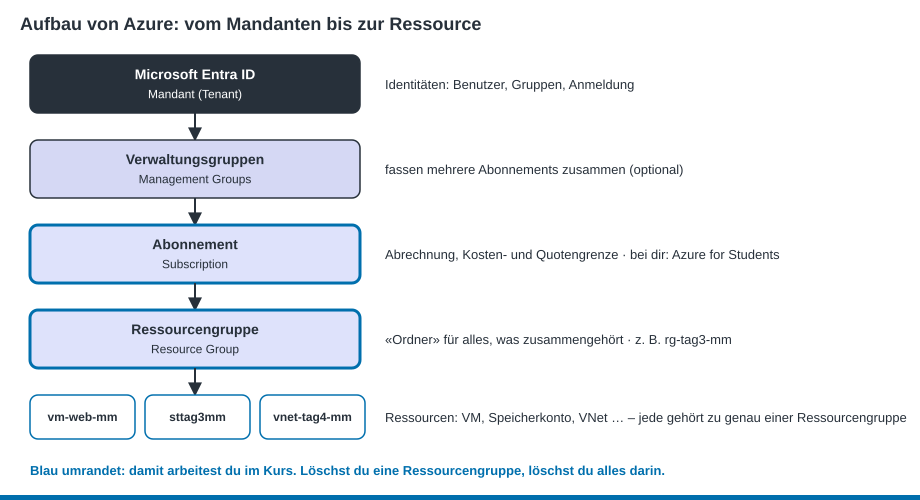
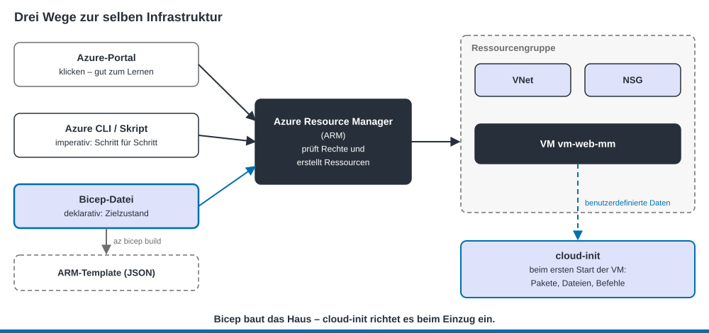

<sub>PAT Cloud Solutions · Einführung in Cloud Computing mit Microsoft Azure · Theorie</sub>

# 3 Aufbau von Azure

Stand: 19.10.2026 · gehört zu [Tag 2](../kurs/tag-2.md)

## Lernziele
- Du kannst Region, Verfügbarkeitszone und Regionspaar (Region Pair) erklären. (K2)
- Du kannst die Hierarchie Mandant (Tenant) → Abonnement → Ressourcengruppe → Ressource beschreiben. (K2)
- Du kannst erklären, warum alle Werkzeuge über den Azure Resource Manager laufen. (K2)
- Du kannst einen Azure-CLI-Befehl lesen und selbst zusammensetzen. (K3)

## Die physische Seite: Regionen und Zonen



| Begriff | Bedeutung | Beispiel |
|---------|-----------|----------|
| **Rechenzentrum** | Gebäude mit Servern, Strom, Kühlung, Netz | – |
| **Verfügbarkeitszone** (Availability Zone) | ein oder mehrere Rechenzentren mit eigenem Strom, eigener Kühlung und eigenem Netz. Eine Region mit Zonen hat mindestens drei davon. | Zone 1, 2, 3 |
| **Region** | Gruppe von Rechenzentren in einem Gebiet, schnell untereinander verbunden. Beim Erstellen einer Ressource wählst du die Region. | Switzerland North (Zürich) |
| **Regionspaar** | zwei Regionen in derselben Geografie. Bei einem Grossausfall hat eine davon Vorrang bei der Wiederherstellung. | Switzerland North ↔ Switzerland West |
| **Geografie** | Gebiet mit eigenen Regeln zu Datenschutz und Datenhaltung | Schweiz |

Azure hat weltweit über 60 Regionen. <!-- prüfen: Stand 19.10.2026 -->

**Warum ist die Region wichtig?**
- **Nähe:** kurze Wege, schnelle Antwortzeiten
- **Recht:** Daten von Schweizer Firmen sollen oft in der Schweiz bleiben.
- **Preis und Angebot:** Nicht jeder Dienst und jede VM-Grösse gibt es in jeder Region. Die Preise unterscheiden sich.

> **Achtung, Azure for Students:** Dein Abonnement erlaubt oft nur bestimmte Regionen. Prüfe zuerst, welche erlaubt sind (Auftrag 2.2).

> **Alltagsvergleich:** Eine Region ist eine Stadt, die Verfügbarkeitszonen sind Quartiere mit eigenem Strom- und Wassernetz. Brennt es in einem Quartier, laufen die anderen weiter.

## Die logische Seite: von Mandant bis Ressource



- **Microsoft Entra ID (Mandant):** Hier sind die Identitäten: wer du bist und wie du dich anmeldest.
- **Verwaltungsgruppen (Management Groups):** fassen in grossen Firmen mehrere Abonnements zusammen, damit Regeln für alle gleichzeitig gelten. Im Kurs brauchst du sie nicht.
- **Abonnement (Subscription):** Hierüber wird abgerechnet. Es setzt auch Grenzen, z. B. wie viele vCPUs du pro Region nutzen darfst (Quota). Dein Abonnement heisst **Azure for Students**.
- **Ressourcengruppe (Resource Group):** Ein Behälter für Ressourcen, die zusammengehören und gemeinsam leben und sterben.
  - Jede Ressource gehört zu **genau einer** Ressourcengruppe.
  - Löschst du die Ressourcengruppe, ist **alles darin weg**. Genau das nutzt du am Ende jedes Labs zum Aufräumen.
  - Die Ressourcengruppe hat selbst eine Region (für ihre Metadaten). Die Ressourcen darin dürfen in anderen Regionen liegen.
- **Ressource:** Ein einzelner Dienst, z. B. eine VM, ein Speicherkonto (Storage Account), ein VNet.

**Tags** sind Etiketten mit Name und Wert, z. B. `kurs=azure-basics`. Damit findest und filterst du Ressourcen und siehst in der Kostenanalyse (Cost Analysis), was wofür ausgegeben wurde.

## Ein Eingang für alles: Azure Resource Manager
Egal ob du im **Portal** klickst, die **Azure CLI** benutzt oder eine **Bicep-Datei** bereitstellst: Alle Anfragen gehen an den **Azure Resource Manager (ARM)**. Er prüft, ob du angemeldet bist und die nötigen Rechte hast, und erstellt dann die Ressourcen. Darum ist das Ergebnis immer gleich, egal welches Werkzeug du benutzt.



## Werkzeuge

| Werkzeug | Was | Wann |
|----------|-----|------|
| **Azure-Portal** | Weboberfläche unter [portal.azure.com](https://portal.azure.com) | Lernen, Überblick, Kontrolle |
| **Cloud Shell** | Terminal im Browser, Azure CLI ist schon installiert und angemeldet | schnell Befehle ausführen, ohne etwas zu installieren |
| **Azure CLI** (`az`) | Befehlszeile für Azure, auch lokal installierbar | wiederholbare Schritte, Skripte |
| **Bicep** | Sprache, um Infrastruktur als Code (Infrastructure as Code) zu beschreiben | Tag 5 |

### So ist ein CLI-Befehl aufgebaut
```text
az   group   create   --name rg-tag2-mm   --location switzerlandnorth   --tags kurs=azure-basics
│    │       │        └─────────────────────── Parameter ──────────────────────────────────┘
│    │       └ Aktion (create, list, show, delete …)
│    └ Ressourcentyp (group, vm, storage account, network vnet …)
└ Azure CLI
```

Nützliche Helfer:

| Befehl / Option | Wirkung |
|-----------------|---------|
| `az <befehl> --help` | zeigt alle Optionen und Beispiele |
| `--output table` | Ausgabe als lesbare Tabelle statt JSON |
| `--query "[].name"` | nur bestimmte Felder anzeigen (JMESPath) |
| `az account show` | Mit welchem Konto und Abonnement bin ich verbunden? |
| `az group list -o table` | Welche Ressourcengruppen habe ich? |

## Ausblick: Identität und Zugriff
Wer darf was in Azure? Das regeln zwei Werkzeuge in **Microsoft Entra ID**:
- **Rollenbasierte Zugriffssteuerung (RBAC):** Eine **Rolle** (z. B. Leser, Mitwirkender, Besitzer) wird einer Person für einen **Bereich** (Scope) zugewiesen, z. B. für eine Ressourcengruppe. Merksatz: *wer* – *was* – *wo*.
- **Bedingter Zugriff (Conditional Access):** Regeln für die Anmeldung, z. B. «Zugriff aufs Portal nur mit Multi-Faktor-Authentifizierung» oder «nicht aus bestimmten Ländern».

Mit Azure for Students hast du dafür keine Rechte. Du übst diese Themen in den **Challenge Labs** von Microsoft Learn for Educators (siehe [Organisation](../kurs/organisation.md#themen-mit-microsoft-entra-id-challenge-labs)).

## Kosten im Griff
- In der **Kostenanalyse** des Abonnements siehst du, was welche Ressource kostet (mit etwas Verzögerung).
- Dein Guthaben bei Azure for Students ist begrenzt. <!-- prüfen: aktuelle Höhe und Laufzeit des Guthabens --> Ist es aufgebraucht, werden deine Ressourcen gestoppt.
- **Faustregel:** Nach jedem Lab die Ressourcengruppe löschen.

## Selbsttest

<details><summary>1. Was ist der Unterschied zwischen einer Region und einer Verfügbarkeitszone?</summary>

Eine Region ist ein Gebiet mit mehreren Rechenzentren (z. B. Zürich). Eine Verfügbarkeitszone ist ein unabhängiger Teil innerhalb einer Region mit eigenem Strom, eigener Kühlung und eigenem Netz.
</details>

<details><summary>2. Du löschst die Ressourcengruppe rg-tag3-mm. Was passiert mit der VM darin?</summary>

Sie wird mit allen anderen Ressourcen der Gruppe gelöscht: Datenträger, NIC, öffentliche IP (Public IP) usw.
</details>

<details><summary>3. Kann eine VM in Switzerland North in einer Ressourcengruppe mit Region West Europe liegen?</summary>

Ja. Die Region der Ressourcengruppe gilt nur für deren Metadaten. Die Ressourcen dürfen in anderen Regionen liegen. Übersichtlicher ist es aber, wenn alles in derselben Region liegt.
</details>

<details><summary>4. Warum kommt im Portal und in der CLI dasselbe heraus?</summary>

Beide schicken ihre Anfrage an den Azure Resource Manager. Er ist der einzige Eingang und erstellt die Ressourcen.
</details>

<details><summary>5. Wie zeigst du mit der CLI alle Ressourcengruppen als Tabelle an?</summary>

`az group list --output table`
</details>

## Quellen
- Microsoft Learn: [Beschreiben der Kernkomponenten der Azure-Architektur](https://learn.microsoft.com/de-de/training/modules/describe-core-architectural-components-of-azure/)
- Microsoft Learn: [Was sind Azure-Verfügbarkeitszonen?](https://learn.microsoft.com/de-de/azure/reliability/availability-zones-overview)
- Microsoft Learn: [Was ist Azure Resource Manager?](https://learn.microsoft.com/de-de/azure/azure-resource-manager/management/overview)
- Microsoft Learn: [Erste Schritte mit der Azure CLI](https://learn.microsoft.com/de-de/cli/azure/get-started-with-azure-cli)
