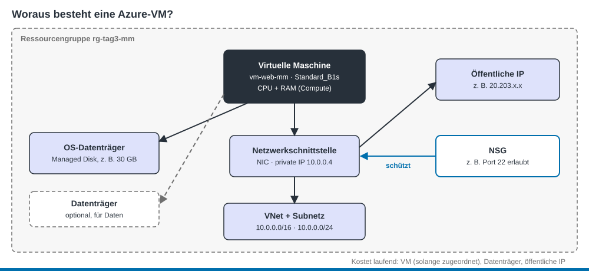

<sub>PAT Cloud Solutions · Einführung in Cloud Computing mit Microsoft Azure · Theorie</sub>

# 4 Azure Compute: virtuelle Maschinen

Stand: 26.10.2026 · gehört zu [Tag 3](../kurs/tag-3.md)

## Lernziele
- Du kannst die Bestandteile einer Azure-VM nennen und ihre Aufgabe erklären. (K2)
- Du kannst für eine Übung eine passende VM-Grösse und ein Image festlegen. (K3)
- Du kannst erklären, welcher VM-Status was kostet. (K2)
- Du kannst dich mit einem SSH-Schlüssel an einer Linux-VM anmelden. (K3)

## Woraus besteht eine VM?
Eine Azure-VM ist nicht eine einzelne Ressource, sondern ein Verbund. Wenn du im Portal eine VM erstellst, legt Azure mehrere Ressourcen in deiner Ressourcengruppe (Resource Group) an:



| Ressource | Aufgabe | Vergleich mit Tag 1 (Multipass) |
|-----------|---------|---------------------------------|
| **Virtuelle Maschine** (Virtual Machine) | CPU und RAM (Compute) | `--cpus`, `--memory` |
| **OS-Datenträger** (OS Disk) | Disk mit dem Betriebssystem (Managed Disk) | `--disk` |
| **Netzwerkschnittstelle (NIC)** | verbindet die VM mit einem Subnetz (Subnet), private IP | IP-Adresse in `multipass list` |
| **VNet + Subnetz** | privates Netz in Azure | kleines privates Netz von Hyper-V |
| **Öffentliche IP** (Public IP) | macht die VM aus dem Internet erreichbar | gab es nicht – die VM war nur von deinem Laptop aus erreichbar |
| **NSG** | Firewall-Regeln: was darf hinein, was hinaus | gab es nicht |

## Grösse und Image
**Grösse (Size):** Bestimmt vCPUs, RAM und Preis. Der Name verrät viel:

```text
Standard_B2ats_v2
         │││││ └ Version
         ││││└ s = Premium SSD möglich
         │││└ t = wenig RAM (tiny)
         ││└ a = AMD-Prozessor
         │└ 2 = Anzahl vCPUs
         └ B = Serie (B = burstable, günstig für wenig Last)
```

| Grösse | vCPU | RAM | Eignung |
|--------|------|-----|---------|
| `Standard_B1s` | 1 | 1 GiB | Übungen, kleiner Webserver |
| `Standard_B2ats_v2` | 2 | 1 GiB | Übungen |
| `Standard_B2s` | 2 | 4 GiB | etwas mehr Last |
<!-- prüfen: Stand 19.10.2026 – Verfügbarkeit und «Free services eligible» im Student-Abo kontrollieren -->

Die **B-Serie** ist «burstable»: Die VM sammelt Guthaben, wenn sie wenig zu tun hat, und darf damit kurz mehr Leistung brauchen. Ideal für Übungen.

**Image:** Die Vorlage für den OS-Datenträger, z. B. Ubuntu Server 24.04 LTS oder Windows Server 2025. Im Kurs arbeitest du mit **Ubuntu**.

## Status und Kosten

| Status | Was läuft? | Was kostet? |
|--------|-----------|-------------|
| **Wird ausgeführt** (Running) | alles | Compute + Disk + öffentliche IP |
| **Beendet** (Stopped), z. B. nach `sudo poweroff` | nichts, aber die Hardware bleibt reserviert | **weiterhin Compute** + Disk + IP |
| **Beendet (Zuordnung aufgehoben)** (Stopped (deallocated)), über «Beenden» im Portal | nichts, Hardware freigegeben | nur Disk + öffentliche IP |
| **Gelöscht** | – | nichts, sofern auch Disk und IP gelöscht sind |

> **Merke:** Herunterfahren aus der VM heraus spart **kein** Geld. Stoppe die VM im Portal oder mit `az vm deallocate`. Am einfachsten: Ressourcengruppe löschen.

## Anmelden mit SSH-Schlüssel
Linux-VMs in Azure meldest du mit deinem **SSH-Schlüsselpaar** (Key Pair) aus Auftrag 1.6 an, nicht mit Passwort. Es funktioniert genau gleich wie bei vm1 an Tag 1. Die ausführliche Erklärung steht in [Kapitel 1](01-virtualisierung.md).


| Schlüssel | Liegt | Schutzbedarf |
|-----------|-------|--------------|
| **privater** Schlüssel (`id_ed25519`) | nur auf deinem Laptop in `~/.ssh/` | maximal: nie teilen, nie in Git, nie per Chat |
| **öffentlicher** Schlüssel (`id_ed25519.pub`) | auf dem Server in `~/.ssh/authorized_keys` | keiner, den darf jeder sehen |

> **Merkhilfe:** Der öffentliche Schlüssel (Public Key) ist ein **Schloss**, das du an beliebig viele Türen montierst. Der private Schlüssel (Private Key) ist der einzige **Schlüssel** dazu.

Beim Erstellen der VM gibst du den **öffentlichen** Schlüssel von deinem Laptop mit (aus Auftrag 1.6):
1. Zeige ihn in PowerShell an und kopiere die ganze Zeile:
   ```powershell
   Get-Content $env:USERPROFILE\.ssh\id_ed25519.pub
   ```
2. Im **Portal** fügst du ihn bei «SSH-Schlüsseltyp» als vorhandenen öffentlichen Schlüssel ein. In der **Cloud Shell** übergibst du ihn als Text:
   ```bash
   az vm create ... --admin-username azureuser --ssh-key-values "ssh-ed25519 AAAA... dein-kommentar"
   ```
3. Danach verbindest du dich **von deinem Laptop** aus, denn dort liegt der private Schlüssel:
   ```powershell
   ssh azureuser@<öffentliche-ip>
   ```

Alternative: `--generate-ssh-keys` erzeugt ein neues RSA-Schlüsselpaar dort, wo die CLI läuft (z. B. in der Cloud Shell), falls dort noch keines existiert. Dann kannst du dich nur von dort aus anmelden.

| Fehlermeldung | Häufige Ursache |
|---------------|-----------------|
| `Connection timed out` | Port 22 in der NSG nicht offen, falsche IP, VM gestoppt |
| `Permission denied (publickey)` | falscher Schlüssel oder falscher Benutzername |
| `REMOTE HOST IDENTIFICATION HAS CHANGED` | neue VM unter alter IP → `ssh-keygen -R <ip>` |

## Selbsttest

<details><summary>1. Du erstellst eine VM im Portal. Welche Ressourcen findest du danach in der Ressourcengruppe?</summary>

VM, OS-Datenträger, Netzwerkschnittstelle, VNet, öffentliche IP, NSG (je nach Einstellungen).
</details>

<details><summary>2. Du fährst die VM mit `sudo poweroff` herunter. Kostet sie noch etwas?</summary>

Ja. Die Hardware bleibt reserviert, also fallen weiter Compute-Kosten an. Erst «Beenden» im Portal (deallocate) gibt sie frei.
</details>

<details><summary>3. Was bedeutet das «2» in `Standard_B2s`?</summary>

Zwei vCPUs.
</details>

<details><summary>4. Ein Kollege will Zugriff auf deine VM. Welchen Schlüssel brauchst du von ihm?</summary>

Seinen öffentlichen Schlüssel. Du trägst ihn in `~/.ssh/authorized_keys` ein. Seinen privaten Schlüssel gibt er nie weiter.
</details>

## Quellen
- TBZ M346: [SSH mit Public/Private Keys](https://gitlab.com/ch-tbz-it/Stud/m346/m346/-/blob/main/Theorie/SSH.md) (Texte übernommen und angepasst)
- Microsoft Learn: [Erstellen einer Linux-VM in Azure](https://learn.microsoft.com/de-de/training/modules/create-linux-virtual-machine-in-azure/)
- Microsoft Learn: [Benennungskonventionen für Azure-VM-Grössen](https://learn.microsoft.com/de-de/azure/virtual-machines/vm-naming-conventions)
- Microsoft Learn: [Zustände und Abrechnungsstatus von Azure-VMs](https://learn.microsoft.com/de-de/azure/virtual-machines/states-billing)
- Microsoft Learn: [Burstfähige VMs der B-Serie](https://learn.microsoft.com/de-de/azure/virtual-machines/sizes/general-purpose/b-family)
