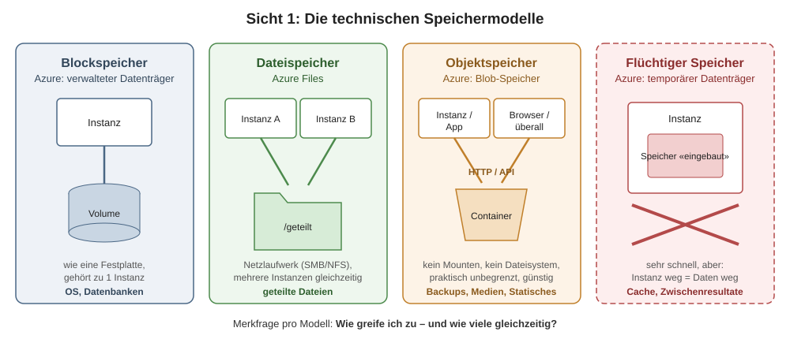
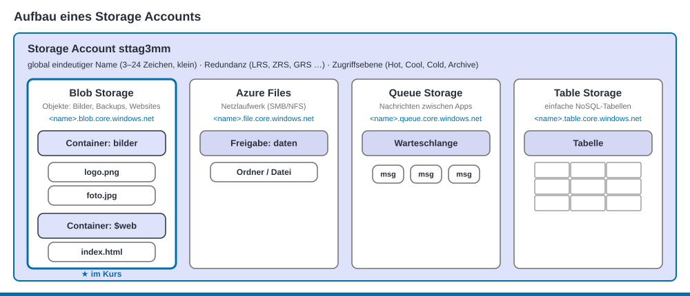
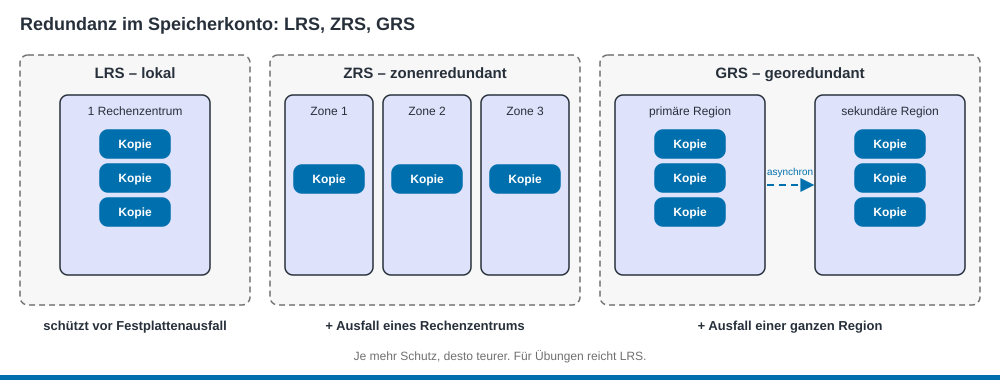
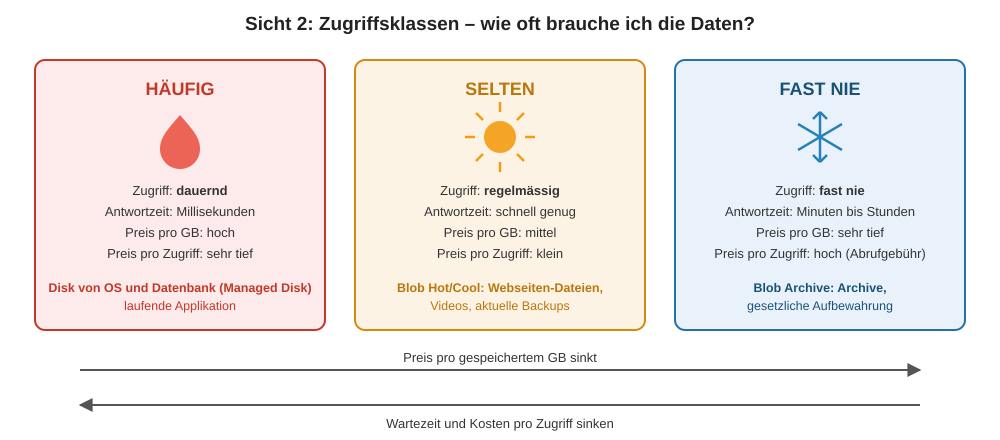
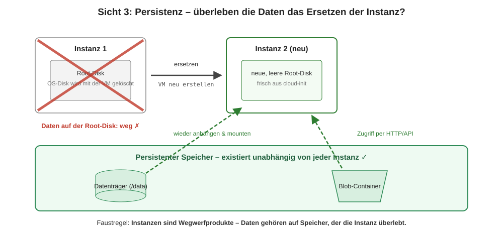

PAT Cloud Solutions · Einführung in Cloud Computing mit Microsoft Azure · Theorie

# 5 Azure Storage

Stand: 19.10.2026 · gehört zu [Tag 3](../kurs/tag-3.md)

## Lernziele
- Du kannst Block-, Datei- und Objektspeicher unterscheiden und Azure-Dienste zuordnen. (K2)
- Du kannst den Aufbau eines Speicherkontos erklären. (K2)
- Du kannst für einen Anwendungsfall eine passende Redundanz und Zugriffsebene (Access Tier) festlegen. (K3)
- Du kannst erklären, welche Daten das Löschen einer VM überleben. (K2)

## Drei Fragen an jeden Speicher
1. **Wie** wird gespeichert? → technisches Modell
2. **Wie oft** wird zugegriffen? → Zugriffsebene
3. **Überleben** die Daten die VM? → Persistenz

## Technische Speichermodelle

Grafik: TBZ M346, für Azure angepasst

| Modell | Azure-Dienst | Zugriff | Mehrere VMs gleichzeitig? | Einsatz |
|--------|--------------|---------|---------------------------|---------|
| Blockspeicher | **verwalteter Datenträger** (Managed Disk) | wie eine Festplatte | nein (Normalfall) | Betriebssystem, Datenbank |
| Dateispeicher | **Azure Files** | Netzlaufwerk (SMB/NFS) | ja | geteilte Dateien |
| Objektspeicher | **Blob-Speicher** (Blob Storage) | HTTP/API, per URL | ja | Bilder, Backups, statische Websites |
| Flüchtiger Speicher | **temporärer Datenträger** (bei manchen VM-Grössen) | wie eine Festplatte | nein | Cache, temporäre Dateien |

## Das Speicherkonto

Ein **Speicherkonto** (Storage Account) ist der Behälter für vier Speicherdienste: **Blob**, **Files**, **Queue** und **Table**. Im Kurs nutzt du vor allem den Blob-Speicher.
- **Name:** global eindeutig, 3–24 Zeichen, nur Kleinbuchstaben und Ziffern, z. B. `sttag3mm`. Der Name wird Teil der URL: `https://sttag3mm.blob.core.windows.net`.
- **Blob-Speicher:** Ein **Container** ist wie ein Ordner, ein **Blob** ist eine Datei darin. Der Spezial-Container `$web` liefert eine **statische Website** (Static Website) aus.
- **Zugriff:** Standardmässig ist alles privat. Zugriff gibt es über die **Zugriffsschlüssel** (Access Key) des Speicherkontos (in der CLI `--auth-mode key`) oder über ein **SAS-Token** (zeitlich begrenzter Link). <!-- prüfen: --auth-mode login braucht die Rolle «Storage-Blob-Datenmitwirkender», im Student-Abo testen -->

## Redundanz: Wie viele Kopien, und wo?

| Option | Kopien | Schützt vor |
|--------|--------|-------------|
| **LRS** – lokal redundant | 3 in einem Rechenzentrum | Ausfall einer Festplatte oder eines Servers |
| **ZRS** – zonenredundant | 3 verteilt auf 3 Zonen | Ausfall eines Rechenzentrums |
| **GRS** – georedundant | 3 lokal + 3 in der gepaarten Region | Ausfall einer ganzen Region |
| **GZRS** | ZRS + Kopie in der gepaarten Region | Kombination aus beiden |

Für Übungen reicht **LRS**, es ist am günstigsten.

## Zugriffsebenen: Hot, Cool, Cold, Archive

Grafik: TBZ M346, für Azure angepasst. Sie zeigt die allgemeine Idee. Azure unterteilt feiner in vier Ebenen:

| Ebene | Zugriff | Mindestdauer | Speichern pro GB | Lesen | Beispiel |
|-------|---------|--------------|------------------|-------|----------|
| **Hot** | häufig | – | am teuersten | am günstigsten | Website-Dateien |
| **Cool** | selten | 30 Tage | günstiger | teurer | Backups der letzten Wochen |
| **Cold** | sehr selten | 90 Tage | noch günstiger | noch teurer | ältere Backups |
| **Archive** | fast nie | 180 Tage | am günstigsten | teuer, Wartezeit von Stunden | gesetzliche Aufbewahrung |

Löschst du eine Datei vor Ablauf der Mindestdauer oder verschiebst du sie in eine andere Ebene, zahlst du eine Gebühr für vorzeitiges Löschen.

**Faustregel:** Je heisser, desto teurer pro GB. Je kälter, desto teurer pro Zugriff.

## Persistenz: Was überlebt?

Grafik: TBZ M346, für Azure angepasst

In der Cloud wird eine VM oft nicht repariert, sondern **ersetzt** (z. B. per Bicep neu erstellt). Darum gilt:
- **Betriebssystem:** Kommt bei jeder neuen VM frisch aus dem Image und cloud-init.
- **Daten:** gehören auf Speicher, der **unabhängig von der VM** existiert, z. B. einen eigenen Datenträger, den Blob-Speicher oder eine Datenbank.

## Selbsttest

1. Eine Web-App speichert hochgeladene Bilder auf dem OS-Datenträger der VM. Die VM wird neu erstellt. Was passiert?

Die Bilder sind weg. Richtig wäre der Blob-Speicher: Er existiert unabhängig von der VM.

2. Warum ist `St-Tag3-MM` kein gültiger Name für ein Speicherkonto?

Nur Kleinbuchstaben und Ziffern sind erlaubt, keine Bindestriche und keine Grossbuchstaben. Richtig: `sttag3mm`.

3. Eine Firma muss Jahresabschlüsse 10 Jahre aufbewahren, liest sie aber fast nie. Welche Zugriffsebene passt?

Archive. Speichern ist sehr günstig, und lange Wartezeiten beim Lesen sind kein Problem.

4. Was ist der Unterschied zwischen LRS und ZRS?

Bei LRS liegen alle drei Kopien im selben Rechenzentrum. Bei ZRS sind sie auf drei Verfügbarkeitszonen (Availability Zone) verteilt und überleben so den Ausfall eines Rechenzentrums.

## Quellen
- TBZ M346: [Speichermodelle](https://gitlab.com/ch-tbz-it/Stud/m346/m346/-/blob/main/Theorie/Speichermodelle.md) (Texte und Grafiken übernommen und für Azure angepasst)
- Microsoft Learn: [Übersicht über Speicherkonten](https://learn.microsoft.com/de-de/azure/storage/common/storage-account-overview)
- Microsoft Learn: [Azure Storage-Redundanz](https://learn.microsoft.com/de-de/azure/storage/common/storage-redundancy)
- Microsoft Learn: [Zugriffsebenen für Blobdaten](https://learn.microsoft.com/de-de/azure/storage/blobs/access-tiers-overview)
- Microsoft Learn: [Hosten statischer Websites in Azure Storage](https://learn.microsoft.com/de-de/azure/storage/blobs/storage-blob-static-website)
