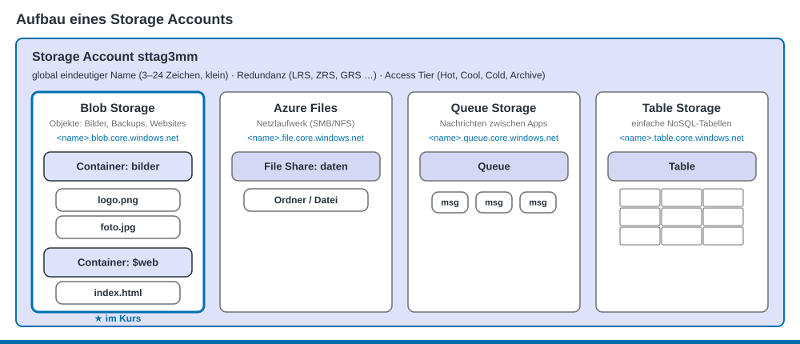
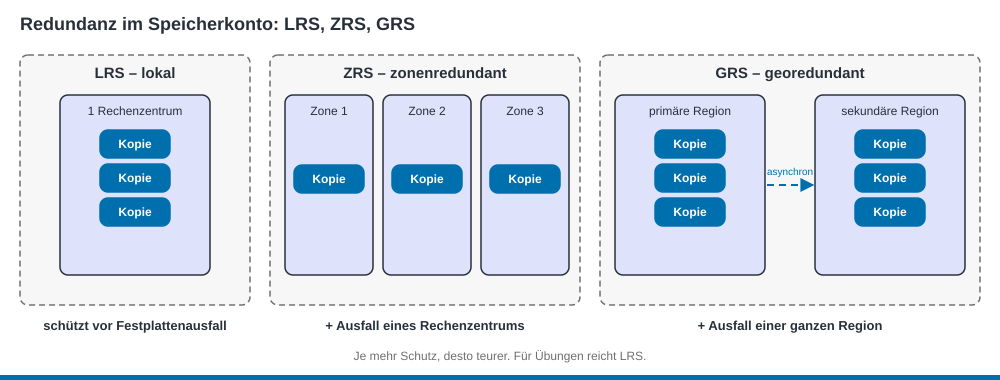
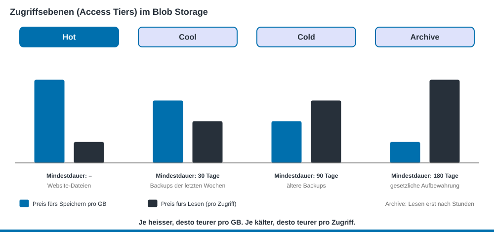
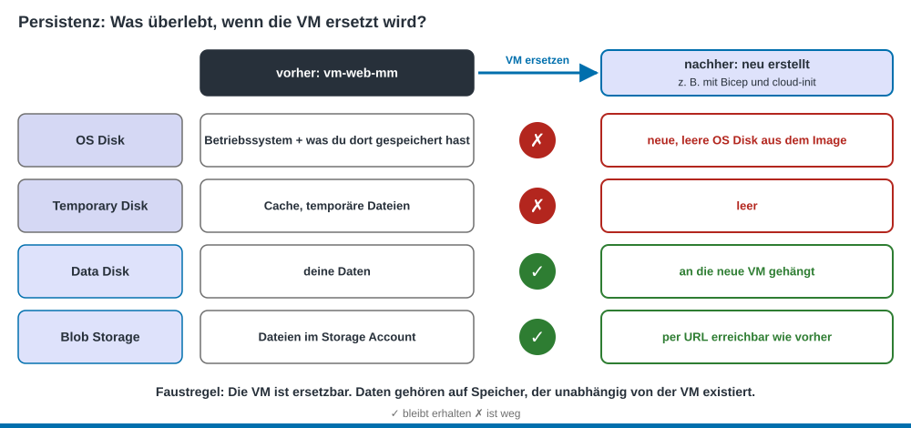

PAT Cloud Solutions · Einführung in Cloud Computing mit Microsoft Azure · Theorie

# 5 Azure Storage

Gehört zu [Tag 3](../kurs/tag-3.md)

## Lernziele
- Du kannst den Aufbau eines Speicherkontos (Storage Account) erklären. (K2)
- Du kannst den vier Diensten im Speicherkonto (Blob, Files, Queue, Table) passende Anwendungsfälle zuordnen. (K2)
- Du kannst für einen Anwendungsfall eine passende Redundanz (Redundancy) und Zugriffsebene (Access Tier) festlegen. (K3)
- Du kannst erklären, welche Daten das Löschen einer VM überleben. (K2)

## Drei Fragen an ein Speicherkonto
1. **Welcher Dienst?** → Blob, Files, Queue oder Table
2. **Wie oft** wird zugegriffen? → Zugriffsebene (Access Tier)
3. **Überleben** die Daten, wenn die VM ersetzt wird? → Persistenz

## Das Speicherkonto

Ein **Speicherkonto** (Storage Account) ist der Behälter für vier Speicherdienste:

| Dienst | Was speichert er? | Zugriff | Beispiel |
|--------|-------------------|---------|----------|
| **Blob** (Blob Storage) | Dateien aller Art, als Objekte | per URL über das Internet (HTTP) | Bilder, Backups, statische Website (Static Website) |
| **Files** (Azure Files) | Ordner und Dateien wie auf einem Netzlaufwerk | über das Netzwerk (SMB), viele gleichzeitig | gemeinsame Ablage statt eigener Fileserver |
| **Queue** (Queue Storage) | Nachrichten in einer Warteschlange | durch Programme | Bestellungen, die nacheinander abgearbeitet werden |
| **Table** (Table Storage) | einfache Tabellen ohne festes Schema | durch Programme | Einstellungen, Protokolle |

Im Kurs nutzt du den Blob-Speicher (Blob Storage). Files, Queue und Table musst du nur zuordnen können.

> [!NOTE]
> Die Festplatten deiner VM liegen **nicht** im Speicherkonto (Storage Account). Sie sind verwaltete Datenträger (Managed Disks), eigene Ressourcen in der Ressourcengruppe (Resource Group). Mehr dazu in [Kapitel 4](04-azure-compute.md), Abschnitt «Speicher der VM».

- **Name:** global eindeutig, 3–24 Zeichen, nur Kleinbuchstaben und Ziffern, z. B. `sttag3mm`. Der Name wird Teil der URL: `https://sttag3mm.blob.core.windows.net`.
- **Blob-Speicher:** Ein **Container** ist wie ein Ordner, ein **Blob** ist eine Datei darin. Der Spezial-Container `$web` liefert eine **statische Website** (Static Website) aus.
- **Zugriff:** Standardmässig ist alles privat. Zugriff gibt es über die **Zugriffsschlüssel** (Access Key) des Speicherkontos (in der CLI `--auth-mode key`) oder über ein **SAS-Token** (zeitlich begrenzter Link). <!-- prüfen: --auth-mode login braucht die Rolle «Storage-Blob-Datenmitwirkender», im Student-Abo testen -->

## Redundanz: Wie viele Kopien, und wo?

| Option | Kopien | Schützt vor | Dauerhaftigkeit (Durability) pro Jahr |
|--------|--------|-------------|------------------|
| **LRS** – lokal redundant (Locally Redundant Storage) | 3 in einem Rechenzentrum | Ausfall einer Festplatte oder eines Servers | 99,999999999 % (11 Neunen) |
| **ZRS** – zonenredundant (Zone-Redundant Storage) | 3 verteilt auf 3 Zonen | Ausfall eines Rechenzentrums | 99,9999999999 % (12 Neunen) |
| **GRS** – georedundant (Geo-Redundant Storage) | 3 lokal + 3 in der gepaarten Region | Ausfall einer ganzen Region | 99,99999999999999 % (16 Neunen) |
| **GZRS** | ZRS + 3 in der gepaarten Region | Kombination aus beiden | 99,99999999999999 % (16 Neunen) |

Für Übungen reicht **LRS**, es ist am günstigsten.

### Was bedeuten die Neunen?
Die **Dauerhaftigkeit (Durability)** sagt, wie wahrscheinlich eine Datei ein Jahr lang **nicht** verloren geht. Jede Neun mehr macht das Risiko zehnmal kleiner.

| Beispiel: 10 Millionen Dateien | statistisch geht 1 Datei verloren in … |
|-------------------------------|----------------------------------------|
| LRS (11 Neunen) | 10 000 Jahren |
| ZRS (12 Neunen) | 100 000 Jahren |
| GRS (16 Neunen) | 1 Milliarde Jahren |

Bei GRS liegt die zweite Region Hunderte Kilometer entfernt. Auch ein Erdbeben oder ein Hochwasser in der einen Region zerstört deine Daten darum nicht. Die Kopie in die zweite Region läuft aber **zeitversetzt** (asynchron). Fällt die Hauptregion aus, können die letzten Minuten fehlen.

> [!IMPORTANT]
> **Redundanz (Redundancy) ist kein Backup.** Alle Kopien sind immer gleich. Löschst oder überschreibst du eine Datei, passiert das sofort in allen Kopien. Gegen Fehler von Menschen hilft zum Beispiel das vorläufige Löschen (Soft Delete).

## Zugriffsebenen: Hot, Cool, Cold, Archive

| Ebene | Zugriff | Mindestdauer | Speichern pro GB | Lesen | Beispiel |
|-------|---------|--------------|------------------|-------|----------|
| **Hot** | häufig | – | am teuersten | am günstigsten | Website-Dateien |
| **Cool** | selten | 30 Tage | günstiger | teurer | Backups der letzten Wochen |
| **Cold** | sehr selten | 90 Tage | noch günstiger | noch teurer | ältere Backups |
| **Archive** | fast nie | 180 Tage | am günstigsten | teuer, Wartezeit von Stunden | gesetzliche Aufbewahrung |

Löschst du eine Datei vor Ablauf der Mindestdauer oder verschiebst du sie in eine andere Ebene, zahlst du eine Gebühr für vorzeitiges Löschen.

**Faustregel:** Je heisser, desto teurer pro GB. Je kälter, desto teurer pro Zugriff.

## Persistenz: Was überlebt?

In der Cloud wird eine VM oft nicht repariert, sondern **ersetzt** (z. B. per Bicep neu erstellt). Darum gilt:
- **Betriebssystem:** Kommt bei jeder neuen VM frisch aus dem Image und cloud-init.
- **Daten:** gehören auf Speicher, der **unabhängig von der VM** existiert, z. B. den Blob-Speicher (Blob Storage), Azure Files oder eine Datenbank. Auch eine eigene Datenfestplatte (Data Disk) geht (siehe Kapitel 4). Nie auf den temporären Datenträger (Temporary Disk).

## Selbsttest

1. Eine Web-App speichert hochgeladene Bilder auf dem OS-Datenträger der VM. Die VM wird neu erstellt. Was passiert?

Die Bilder sind weg. Richtig wäre der Blob-Speicher (Blob Storage): Er existiert unabhängig von der VM.

2. Warum ist `St-Tag3-MM` kein gültiger Name für ein Speicherkonto?

Nur Kleinbuchstaben und Ziffern sind erlaubt, keine Bindestriche und keine Grossbuchstaben. Richtig: `sttag3mm`.

3. Eine Firma muss Jahresabschlüsse 10 Jahre aufbewahren, liest sie aber fast nie. Welche Zugriffsebene passt?

Archive. Speichern ist sehr günstig, und lange Wartezeiten beim Lesen sind kein Problem.

4. Die Velo Zürich AG will ihren alten Fileserver ablösen. Alle Mitarbeitenden sollen ein Netzlaufwerk verbinden. Welcher Dienst im Speicherkonto passt?

Files (Azure Files). Es stellt ein Netzlaufwerk über SMB bereit, auf das viele gleichzeitig zugreifen.

5. Was ist der Unterschied zwischen LRS und ZRS?

Bei LRS liegen alle drei Kopien im selben Rechenzentrum. Bei ZRS sind sie auf drei Verfügbarkeitszonen (Availability Zones) verteilt und überleben so den Ausfall eines Rechenzentrums.

6. Jemand löscht versehentlich eine Datei in einem Speicherkonto mit GRS (16 Neunen). Ist die Datei in der zweiten Region noch da?

Nein. Redundanz (Redundancy) schützt vor Hardware-Ausfällen, nicht vor Löschen. Das Löschen gilt für alle Kopien. Retten kann man die Datei nur mit vorläufigem Löschen (Soft Delete) oder einem Backup.

## Quellen
- TBZ M346: [Speichermodelle](https://gitlab.com/ch-tbz-it/Stud/m346/m346/-/blob/main/Theorie/Speichermodelle.md) (als Quelle für die Texte, für Azure angepasst)
- Microsoft Learn: [Übersicht über Speicherkonten](https://learn.microsoft.com/de-de/azure/storage/common/storage-account-overview)
- Microsoft Learn: [Einführung in Azure Storage](https://learn.microsoft.com/de-de/azure/storage/common/storage-introduction)
- Microsoft Learn: [Azure Storage-Redundanz](https://learn.microsoft.com/de-de/azure/storage/common/storage-redundancy)
- Microsoft Learn: [Zugriffsebenen für Blobdaten](https://learn.microsoft.com/de-de/azure/storage/blobs/access-tiers-overview)
- Microsoft Learn: [Hosten statischer Websites in Azure Storage](https://learn.microsoft.com/de-de/azure/storage/blobs/storage-blob-static-website)
