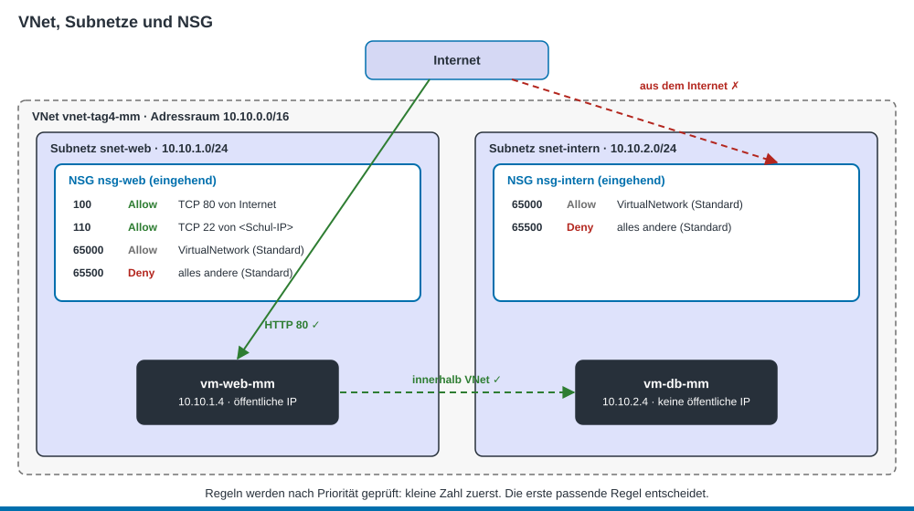
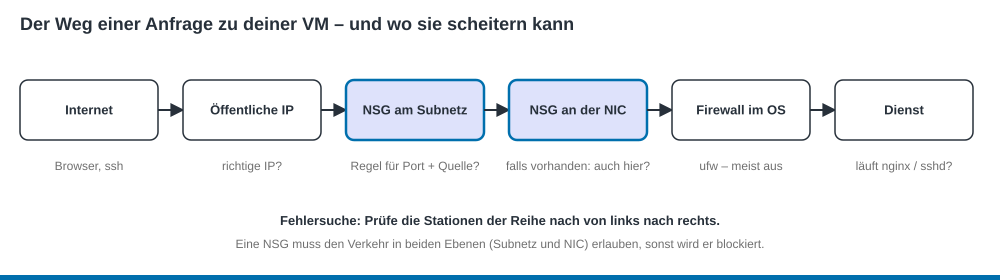

PAT Cloud Solutions · Einführung in Cloud Computing mit Microsoft Azure · Theorie

# 6 Azure Networking

Stand: 19.10.2026 · gehört zu [Tag 4](../kurs/tag-4.md)

## Lernziele
- Du kannst die Begriffe VNet, Adressraum, Subnetz und CIDR erklären. (K2)
- Du kannst einen Adressraum in Subnetze aufteilen. (K3)
- Du kannst private und öffentliche IP-Adressen in Azure unterscheiden. (K2)
- Du kannst NSG-Regeln lesen, schreiben und ihre Wirkung vorhersagen. (K3)
- Du kannst bei einem Verbindungsproblem mit einer Checkliste die Ursache finden. (K4)

## VNet und Subnetze

- **Virtuelles Netzwerk (VNet):** dein eigenes, isoliertes Netz in Azure. Andere Kunden sehen es nicht. Ein VNet liegt in **einer** Region.
- **Adressraum:** der IP-Bereich des VNets, z. B. `10.10.0.0/16`. Verwende private Bereiche: `10.0.0.0/8`, `172.16.0.0/12` oder `192.168.0.0/16`.
- **Subnetz:** ein Teilbereich des VNets, z. B. `10.10.1.0/24`. Jede NIC hängt in genau einem Subnetz. Subnetze trennen Aufgaben, z. B. Webserver und Datenbanken.

### CIDR in Kürze
Die Zahl nach dem `/` sagt, wie viele Bits **fix** sind. Je grösser die Zahl, desto kleiner das Netz.

| CIDR | Adressen | in Azure nutzbar | Beispiel |
|------|----------|------------------|----------|
| `/16` | 65 536 | – (Adressraum) | `10.10.0.0/16` = 10.10.0.0 – 10.10.255.255 |
| `/24` | 256 | 251 | `10.10.1.0/24` = 10.10.1.0 – 10.10.1.255 |
| `/27` | 32 | 27 | `10.10.3.0/27` = 10.10.3.0 – 10.10.3.31 |
| `/29` | 8 | 3 | kleinstes erlaubtes Subnetz |

**Azure reserviert in jedem Subnetz 5 Adressen:** die erste (Netzadresse), `.1` (Gateway), `.2` und `.3` (Azure-DNS) und die letzte (Broadcast). Die erste VM in `10.10.1.0/24` bekommt darum `10.10.1.4`.

> **Alltagsvergleich:** Das VNet ist ein Firmengelände mit eigenem Zaun, die Subnetze sind die Gebäude darauf. Die IP-Adresse ist die Büronummer.

## IP-Adressen in Azure

| Typ | Erreichbar | Bemerkung |
|-----|-----------|-----------|
| **Private IP** | nur im VNet (und verbundenen Netzen) | kommt aus dem Subnetz, bleibt bei Neustarts gleich |
| **Öffentliche IP** (Standard-SKU) | aus dem Internet | eigene Ressource, statisch, kostet auch bei gestoppter VM. Standardmässig ist alles gesperrt, bis eine NSG-Regel Verkehr erlaubt. |

<!-- prüfen: Stand 19.10.2026 – Seit 2026 sind neue Subnetze standardmässig «privat» (kein Standard-Internetzugang ausgehend). Eine VM ohne öffentliche IP kommt dann nicht ins Internet (z. B. für apt). Vor Tag 4/5 im Student-Abo testen. -->
> **Achtung:** Eine VM **ohne** öffentliche IP kommt in neuen Subnetzen unter Umständen auch **nicht ins Internet**, z. B. für `apt install`. Für die Übungen gibst du der VM, die Pakete braucht, eine öffentliche IP.

## Network Security Groups (NSG)
Eine **NSG** ist eine Liste von Regeln, die Verkehr erlaubt oder blockiert. Du verknüpfst sie mit einem **Subnetz** (empfohlen) oder mit einer **NIC**.

> **Alltagsvergleich:** Ein Türsteher mit Gästeliste. Er geht die Liste von oben nach unten durch. Der erste Eintrag, der passt, entscheidet.

Jede Regel hat:

| Feld | Beispiel |
|------|----------|
| **Priorität** | 100 (100–4096, kleine Zahl wird zuerst geprüft) |
| **Quelle** | IP-Bereich, z. B. `203.0.113.10/32`, oder Diensttag `Internet`, `VirtualNetwork` |
| **Ziel** | meist `Any` oder ein Subnetz |
| **Zielport** | 22, 80, 443 … |
| **Protokoll** | TCP, UDP, ICMP, Any |
| **Aktion** | Allow oder Deny |

**Standardregeln** (können nicht gelöscht werden; eine eigene Regel mit **kleinerer Prioritätszahl** wird aber früher geprüft und übersteuert sie):

| Richtung | Priorität | Regel | Wirkung |
|----------|-----------|-------|---------|
| eingehend | 65000 | AllowVnetInBound | Verkehr innerhalb des VNets erlaubt |
| eingehend | 65001 | AllowAzureLoadBalancerInBound | Azure-Load-Balancer erlaubt |
| eingehend | 65500 | DenyAllInBound | **alles andere blockiert** |
| ausgehend | 65000 | AllowVnetOutBound | ins VNet erlaubt |
| ausgehend | 65001 | AllowInternetOutBound | ins Internet erlaubt |
| ausgehend | 65500 | DenyAllOutBound | alles andere blockiert |

Wichtig:
- **NSGs sind zustandsbehaftet (stateful):** Ist eine eingehende Anfrage erlaubt, darf die Antwort automatisch zurück. Du brauchst dafür keine ausgehende Regel.
- **Quelle einschränken:** SSH (Port 22) nie für `Any` öffnen, sondern nur für deine eigene IP.

### Wichtige Ports

| Port | Dienst |
|------|--------|
| 22 | SSH |
| 80 | HTTP |
| 443 | HTTPS |
| 3389 | RDP (Windows-Remotedesktop) |

## Der Weg einer Anfrage

Wenn «es nicht geht», prüfe die Stationen der Reihe nach:
1. **Richtige IP?** Öffentliche IP im Portal nachschauen.
2. **NSG am Subnetz:** Gibt es eine Allow-Regel für Port und Quelle? Hat sie eine **kleinere Prioritätszahl** als jede passende Deny-Regel, wird also früher geprüft?
3. **NSG an der NIC:** Falls vorhanden, muss sie den Verkehr **ebenfalls** erlauben.
4. **Firewall im Betriebssystem:** bei Ubuntu in Azure meist aus (`sudo ufw status`).
5. **Dienst:** Läuft er? (`systemctl status nginx`) Hört er auf dem richtigen Port? (`ss -tlnp`)

Im Portal hilft dir unter **VM > Netzwerk** die Ansicht **Effektive Sicherheitsregeln**.

## Selbsttest

1. Wie viele VMs passen höchstens in das Subnetz 10.10.1.0/28?

16 Adressen − 5 reservierte = 11.

2. Liegt 10.10.2.20 im Subnetz 10.10.1.0/24?

Nein. Bei `/24` sind die ersten drei Oktette fix. 10.10.**2**.20 gehört zu 10.10.2.0/24.

3. Eine NSG hat Regel 100 «Deny TCP 80 von Any» und Regel 200 «Allow TCP 80 von Any». Ist die Website erreichbar?

Nein. Regel 100 wird zuerst geprüft und passt. Danach wird nicht weitergesucht.

4. Du hast keine ausgehende Regel erstellt. Kommt die Antwort des Webservers trotzdem beim Browser an?

Ja. NSGs sind zustandsbehaftet: Die Antwort auf eine erlaubte Anfrage darf automatisch zurück.

5. Port 80 ist in der NSG erlaubt, trotzdem lädt die Website nicht. Was prüfst du als Nächstes?

Ob eine NSG an der NIC den Verkehr blockiert, ob der Webserver läuft (`systemctl status nginx`) und ob du die richtige öffentliche IP verwendest.

## Quellen
- TBZ M346: [Netzwerk und Sicherheit](https://gitlab.com/ch-tbz-it/Stud/m346/m346/-/blob/main/Theorie/NetzwerkSicherheit.md) (Struktur und Texte übernommen und für Azure angepasst)
- Microsoft Learn: [Was ist Azure Virtual Network?](https://learn.microsoft.com/de-de/azure/virtual-network/virtual-networks-overview)
- Microsoft Learn: [Netzwerksicherheitsgruppen](https://learn.microsoft.com/de-de/azure/virtual-network/network-security-groups-overview)
- Microsoft Learn: [Funktionsweise von Netzwerksicherheitsgruppen](https://learn.microsoft.com/de-de/azure/virtual-network/network-security-group-how-it-works)
- Microsoft Learn: [Virtual Network – häufig gestellte Fragen (reservierte Adressen)](https://learn.microsoft.com/de-de/azure/virtual-network/virtual-networks-faq)
- Microsoft Learn: [Standardmässiger ausgehender Zugriff](https://learn.microsoft.com/de-de/azure/virtual-network/ip-services/default-outbound-access)
