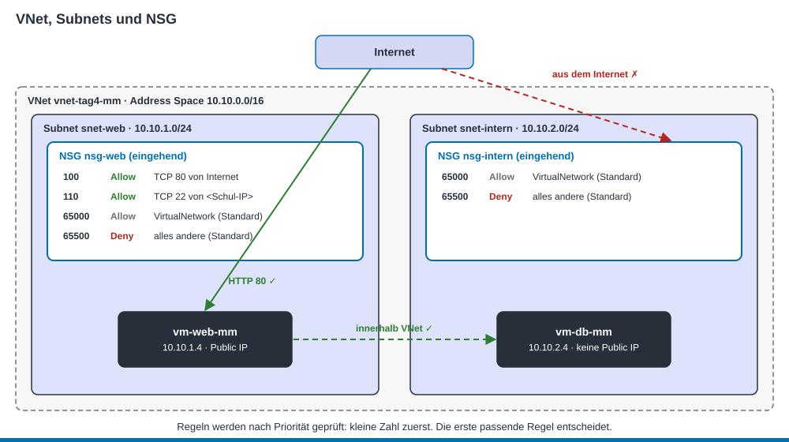
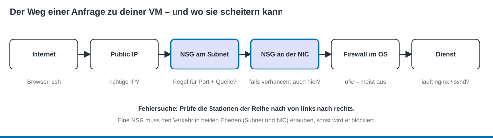

PAT Cloud Solutions · Einführung in Cloud Computing mit Microsoft Azure · Theorie

# 6 Azure Networking

Gehört zu [Tag 4](../kurs/tag-4.md)

## Lernziele
- Du kannst die Begriffe VNet, Adressraum (Address Space), Subnetz (Subnet) und CIDR erklären. (K2)
- Du kannst einen Adressraum (Address Space) in Subnetze (Subnets) aufteilen. (K3)
- Du kannst zu einer IP-Adresse mit Präfix die Netzadresse (Network Address) binär berechnen. (K3)
- Du kannst private und öffentliche IP-Adressen (Public IP) in Azure unterscheiden. (K2)
- Du kannst Sicherheitsregeln (Security Rules) einer NSG lesen, schreiben und ihre Wirkung vorhersagen. (K3)
- Du kannst bei einem Verbindungsproblem mit einer Checkliste die Ursache finden. (K4)

## VNet und Subnetze

- **Virtuelles Netzwerk (VNet):** dein eigenes, isoliertes Netz in Azure. Andere Kunden sehen es nicht. Ein VNet liegt in **einer** Region.
- **Adressraum:** der IP-Bereich des VNets, z. B. `10.10.0.0/16`. Verwende private Bereiche: `10.0.0.0/8`, `172.16.0.0/12` oder `192.168.0.0/16`.
- **Subnetz:** ein Teilbereich des VNets, z. B. `10.10.1.0/24`. Jede NIC hängt in genau einem Subnetz (Subnet). Subnetze (Subnets) trennen Aufgaben, z. B. Webserver und Datenbanken.

### CIDR: Was heisst /27?
Eine IPv4-Adresse besteht aus **32 Bits**, aufgeteilt in vier Oktette zu je 8 Bits. Die Zahl nach dem `/` sagt, wie viele Bits von links **zum Netz** gehören. Die restlichen Bits sind für die Geräte im Netz.

Bei `/27` gehören 27 Bits zum Netz. Für die Geräte bleiben 32 − 27 = 5 Bits, also 25 = 32 Adressen. Je grösser die Zahl nach dem `/`, desto kleiner das Netz.

### Die Netzadresse berechnen
**Frage:** In welchem Subnetz (Subnet) liegt die Adresse `10.10.3.40/27`?

**1. Das Präfix als Maske aufschreiben.** `/27` heisst: 27 Einsen, danach Nullen. Das ist die **Subnetzmaske** (Subnet Mask). In Oktetten: 8 + 8 + 8 + **3** Einsen.

**2. Nur das Oktett rechnen, in dem die Grenze liegt.** Ein Oktett mit 8 Einsen (`11111111`) übernimmst du unverändert. Ein Oktett mit 8 Nullen wird `0`. Bei `/27` liegt die Grenze im 4. Oktett.

**3. Die Zahl im 4. Oktett binär schreiben.** Zerlege sie in die Stellenwerte eines Oktetts:

| Stellenwert | 128 | 64 | 32 | 16 | 8 | 4 | 2 | 1 |
|-------------|:---:|:--:|:--:|:--:|:-:|:-:|:-:|:-:|
| 40 = 32 + 8 | 0 | 0 | **1** | 0 | **1** | 0 | 0 | 0 |

**4. IP-Adresse und Maske Bit für Bit mit UND verknüpfen.** Regel: 1 und 1 = 1, sonst 0. Das Ergebnis ist die **Netzadresse** (Network Address).

| | 1. Oktett | 2. Oktett | 3. Oktett | 4. Oktett |
|---|:---:|:---:|:---:|:---:|
| IP-Adresse | 10 | 10 | 3 | 40 |
| binär | 00001010 | 00001010 | 00000011 | 00101000 |
| Maske `/27` | 11111111 | 11111111 | 11111111 | **111**00000 |
| Netzadresse (Network Address) binär | 00001010 | 00001010 | 00000011 | **001**00000 |
| **Netzadresse** (Network Address) | **10** | **10** | **3** | **32** |

**5. Die letzte Adresse finden.** Setze in der Netzadresse (Network Address) alle 5 Bits für die Geräte auf 1: `00100000` wird `00111111` = 63.

**Ergebnis:** `10.10.3.40` liegt im Subnetz (Subnet) `10.10.3.32/27`. Es reicht von `10.10.3.32` bis `10.10.3.63`.

> [!TIP]
> **Abkürzung mit der Blockgrösse:** Ein `/27` hat 32 Adressen. Darum beginnen die Subnetze (Subnets) bei 0, 32, 64, 96 … Die 40 liegt zwischen 32 und 63, also im Block ab 32. Prüfe das Ergebnis immer auch mit der Rechnung oben.

### Wie gross ist ein Subnetz?

| CIDR | Adressen | in Azure nutzbar | Beispiel |
|------|----------|------------------|----------|
| `/16` | 65 536 | 65 531 (meist als Adressraum (Address Space) verwendet) | `10.10.0.0/16` = 10.10.0.0 – 10.10.255.255 |
| `/24` | 256 | 251 | `10.10.1.0/24` = 10.10.1.0 – 10.10.1.255 |
| `/27` | 32 | 27 | `10.10.3.0/27` = 10.10.3.0 – 10.10.3.31 |
| `/29` | 8 | 3 | kleinstes erlaubtes Subnetz (Subnet) |

**Azure reserviert in jedem Subnetz 5 Adressen:** die erste (Netzadresse), `.1` (Gateway), `.2` und `.3` (Azure-DNS) und die letzte (Broadcast). Die erste VM in `10.10.1.0/24` bekommt darum `10.10.1.4`.

> **Alltagsvergleich:** Das VNet ist ein Firmengelände mit eigenem Zaun, die Subnetze (Subnets) sind die Gebäude darauf. Die IP-Adresse ist die Büronummer.

## IP-Adressen in Azure

| Typ | Erreichbar | Bemerkung |
|-----|-----------|-----------|
| **Private IP** | nur im VNet (und verbundenen Netzen) | kommt aus dem Subnetz (Subnet), bleibt bei Neustarts gleich |
| **Öffentliche IP** (Standard-SKU) | aus dem Internet | eigene Ressource, statisch, kostet auch bei gestoppter VM. Standardmässig ist alles gesperrt, bis eine Sicherheitsregel (Security Rule) der NSG Verkehr erlaubt. |

<!-- prüfen: Stand 19.10.2026 – Seit 2026 sind neue Subnetze standardmässig «privat» (kein Standard-Internetzugang ausgehend). Eine VM ohne öffentliche IP kommt dann nicht ins Internet (z. B. für apt). Vor Tag 4/5 im Student-Abo testen. -->
> **Achtung:** Eine VM **ohne** öffentliche IP (Public IP) kommt in neuen Subnetzen (Subnets) unter Umständen auch **nicht ins Internet**, z. B. für `apt install`. Für die Übungen gibst du der VM, die Pakete braucht, eine öffentliche IP (Public IP).

## Netzwerksicherheitsgruppen (NSG)
Eine **Netzwerksicherheitsgruppe (Network Security Group, NSG)** ist eine Liste von **Sicherheitsregeln (Security Rules)**, die Verkehr erlauben oder blockieren. Du verknüpfst sie mit einem **Subnetz** (empfohlen) oder mit einer **NIC**.

> **Alltagsvergleich:** Ein Türsteher mit Gästeliste. Er geht die Liste von oben nach unten durch. Der erste Eintrag, der passt, entscheidet.

Jede Sicherheitsregel (Security Rule) hat:

| Feld | Beispiel |
|------|----------|
| **Priorität** (Priority) | 100 (100–4096, kleine Zahl wird zuerst geprüft) |
| **Quelle** (Source) | IP-Bereich, z. B. `203.0.113.10/32`, oder Diensttag (Service Tag) `Internet`, `VirtualNetwork` |
| **Ziel** (Destination) | meist `Any` oder ein Subnetz (Subnet) |
| **Zielport** (Destination Port) | 22, 80, 443 … |
| **Protokoll** (Protocol) | TCP, UDP, ICMP, Any |
| **Aktion** (Action) | Allow oder Deny |

**Standardsicherheitsregeln** (Default Security Rules) können nicht gelöscht werden. Eine eigene Sicherheitsregel (Security Rule) mit **kleinerer Prioritätszahl** (Priority) wird aber früher geprüft und übersteuert sie:

| Richtung | Priorität (Priority) | Sicherheitsregel (Security Rule) | Wirkung |
|----------|-----------|-------|---------|
| eingehend | 65000 | AllowVnetInBound | Verkehr innerhalb des VNets erlaubt |
| eingehend | 65001 | AllowAzureLoadBalancerInBound | Azure-Load-Balancer erlaubt |
| eingehend | 65500 | DenyAllInBound | **alles andere blockiert** |
| ausgehend | 65000 | AllowVnetOutBound | ins VNet erlaubt |
| ausgehend | 65001 | AllowInternetOutBound | ins Internet erlaubt |
| ausgehend | 65500 | DenyAllOutBound | alles andere blockiert |

Wichtig:
- **NSGs sind zustandsbehaftet (stateful):** Ist eine eingehende Anfrage erlaubt, darf die Antwort automatisch zurück. Du brauchst dafür keine ausgehende Sicherheitsregel (Security Rule).
- **Quelle einschränken:** SSH (Port 22) nie für `Any` öffnen, sondern nur für deine eigene IP.

### Wichtige Ports

| Port | Dienst |
|------|--------|
| 22 | SSH |
| 80 | HTTP |
| 443 | HTTPS |
| 3389 | RDP (Windows-Remotedesktop) |

## Der Weg einer Anfrage

Wenn «es nicht geht», prüfe die Stationen der Reihe nach:
1. **Richtige IP?** Öffentliche IP (Public IP) im Portal nachschauen.
2. **NSG am Subnetz:** Gibt es eine Sicherheitsregel (Security Rule) mit Allow für Port und Quelle (Source)? Hat sie eine **kleinere Prioritätszahl** (Priority) als jede passende Sicherheitsregel (Security Rule) mit Deny, wird also früher geprüft?
3. **NSG an der NIC:** Falls vorhanden, muss sie den Verkehr **ebenfalls** erlauben.
4. **Firewall im Betriebssystem:** bei Ubuntu in Azure meist aus (`sudo ufw status`).
5. **Dienst:** Läuft er? (`systemctl status nginx`) Hört er auf dem richtigen Port? (`ss -tlnp`)

Im Portal hilft dir bei der VM unter **Netzwerkeinstellungen** (Network settings) die Ansicht **Effektive Sicherheitsregeln** (Effective security rules). Die **NIC** ist die Netzwerkschnittstelle (Network Interface) der VM.

## Selbsttest

1. Wie viele VMs passen höchstens in das Subnetz 10.10.1.0/28?

16 Adressen − 5 reservierte = 11.

2. Liegt 10.10.2.20 im Subnetz 10.10.1.0/24?

Nein. Bei `/24` sind die ersten drei Oktette fix. 10.10.**2**.20 gehört zu 10.10.2.0/24.

3. Eine NSG hat zwei Sicherheitsregeln (Security Rules): 100 «Deny TCP 80 von Any» und 200 «Allow TCP 80 von Any». Ist die Website erreichbar?

Nein. Die Sicherheitsregel (Security Rule) 100 wird zuerst geprüft und passt. Danach wird nicht weitergesucht.

4. Du hast keine ausgehende Sicherheitsregel (Security Rule) erstellt. Kommt die Antwort des Webservers trotzdem beim Browser an?

Ja. NSGs sind zustandsbehaftet: Die Antwort auf eine erlaubte Anfrage darf automatisch zurück.

5. Port 80 ist in der NSG erlaubt, trotzdem lädt die Website nicht. Was prüfst du als Nächstes?

Ob eine NSG an der NIC den Verkehr blockiert, ob der Webserver läuft (`systemctl status nginx`) und ob du die richtige öffentliche IP (Public IP) verwendest.

6. In welchem Subnetz (Subnet) liegt die Adresse 10.10.5.70/26? Von wo bis wo reicht es?

`/26` = 8 + 8 + 8 + **2** Einsen, Maske im 4. Oktett `11000000`. 70 = 64 + 4 + 2 = `01000110`. UND: `01000000` = 64. Das Subnetz (Subnet) ist `10.10.5.64/26`, es reicht von `10.10.5.64` bis `10.10.5.127` (`01111111`). Abkürzung: Blockgrösse 64, Blöcke bei 0, 64, 128, 192.

## Quellen
- TBZ M346: [Netzwerk und Sicherheit](https://gitlab.com/ch-tbz-it/Stud/m346/m346/-/blob/main/Theorie/NetzwerkSicherheit.md) (Struktur und Texte übernommen und für Azure angepasst)
- Microsoft Learn: [Was ist Azure Virtual Network?](https://learn.microsoft.com/de-de/azure/virtual-network/virtual-networks-overview)
- Microsoft Learn: [Netzwerksicherheitsgruppen](https://learn.microsoft.com/de-de/azure/virtual-network/network-security-groups-overview)
- Microsoft Learn: [Funktionsweise von Netzwerksicherheitsgruppen](https://learn.microsoft.com/de-de/azure/virtual-network/network-security-group-how-it-works)
- Microsoft Learn: [Virtual Network – häufig gestellte Fragen (reservierte Adressen)](https://learn.microsoft.com/de-de/azure/virtual-network/virtual-networks-faq)
- Microsoft Learn: [Standardmässiger ausgehender Zugriff](https://learn.microsoft.com/de-de/azure/virtual-network/ip-services/default-outbound-access)
